Witness Test Report
===================

Test Setup
----------

Development Board
^^^^^^^^^^^^^^^^^

**Board Model:** ESP32-C6-DevKitC-1

The ESP32-C6-DevKitC-1 is a development board based on the ESP32-C6 SoC. This board provides access to the built-in USB Serial/JTAG controller through the chip USB Type-C connector (GPIO12 is USB D-, GPIO13 is USB D+), enabling direct debugging, memory inspection, and fault injection capabilities without requiring an external debugger.

.. figure:: ../_static/esp32-c6-devkitc-1-v1.2-annotated-photo.png
   :align: center
   :alt: ESP32-C6-DevKitC-1
   :name: fig-devkit-board

   ESP32-C6-DevKitC-1 - front

The onboard indicators include an addressable RGB LED connected to GPIO8 and a 3.3 V power LED. Standard GPIO output tests require bi-directional digital driving and readback, so the addressable RGB LED on GPIO8 is left unassigned by the test logic. An external LED is connected to GPIO7, matching the default ``LED_GPIO`` pin mapping of the standalone sample application.

The ESP32-C6-DevKitC-1 does not include an onboard 32.768 kHz crystal oscillator. Dual header pins for GPIO0 (``XTAL_32K_P``) and GPIO1 (``XTAL_32K_N``) provide external connection points for the 32.768 kHz reference crystal required to validate the main crystal frequency.

Hardware Connections
^^^^^^^^^^^^^^^^^^^^

The following table describes the hardware connections used during the witness test:

.. list-table:: Hardware Connections
   :header-rows: 1
   :widths: 30 70

   * - Component
     - GPIO Pin(s)
   * - External LED
     - GPIO7 (``LED_GPIO``)
   * - Built-in Button
     - GPIO9 (``BTN_GPIO``, idle high; input check executes post-boot)
   * - USB Serial/JTAG (Debug)
     - USB_D- (GPIO12) / USB_D+ (GPIO13) via USB Type-C connector
   * - External Crystal
     - XTAL_32K_P (GPIO0) / XTAL_32K_N (GPIO1)
   * - ADC Channel
     - ADC1 Channel 2 (GPIO2)

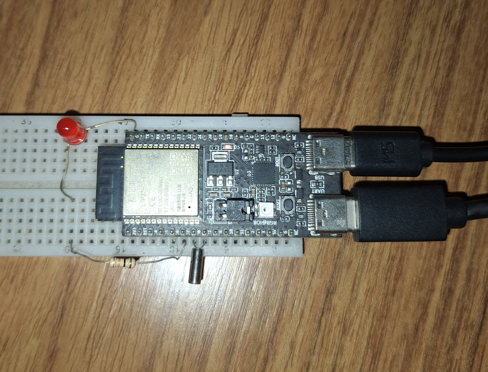

   Development Board Connection

JTAG Connection
^^^^^^^^^^^^^^^

**Connection Method:** USB Serial/JTAG Controller via USB D-/D+ Lines

The development board is connected to the host system using a USB cable connected to the chip USB Type-C port (USB D-/D+ lines).

This connection provides direct access to the built-in USB Serial/JTAG peripheral, which enables:

- Real-time debugging and monitoring
- Register and memory inspection
- Fault injection via JTAG debugger
- Execution control (breakpoints, single-step, etc.)

Test Application
^^^^^^^^^^^^^^^^

**Application:** Standalone Sample Application (``samples/standalone``)

The witness test certification process uses the standalone sample application located in ``samples/standalone``. This application is used as-is without any modifications, providing a complete reference implementation that demonstrates the integration of the ESP-BIST library in a safety-critical application.

The standalone application includes:

- Post-boot self-tests for hardware integrity verification (external crystal test fallback, main crystal test, March A test, Abraham full test, flash CRC test, stack overflow test, GPIO output test, GPIO input test, ADC low and high tests, software interrupt source map test, and hardware timer interrupt test)
- Runtime monitoring capabilities (CPU integer general-purpose registers test, CPU CSR test including PMA address registers, stack overflow canary check, and program counter test)
- Watchdog integration (two-boot MWDT test and runtime windowed watchdog underflow protection)
- Fail-safe error handling
- GPIO validation
- ADC validation

This application serves as the baseline for all witness test scenarios, ensuring that the certification process validates the BIST library behavior in a realistic application context.

Certification Process
---------------------

The certification process consists of multiple test scenarios, each designed to validate a specific aspect of the BIST library's fault detection capabilities. For each test:

1. **Successful Run**: The test is executed under normal conditions to establish a baseline of expected behavior
2. **Error Injection**: A specific hardware fault or error condition is injected via JTAG
3. **Evidence Collection**: Data is collected to demonstrate that:

   - The error was successfully injected
   - The BIST library detected the error
   - The system responded appropriately to the detected error

Test Scenarios
--------------

Test 1: Watchdog Operation Test
--------------------------------

**Purpose:** Verify that the watchdog timer functions correctly to detect and recover from system faults through a two-boot sequence validation.

**Test Component:** Watchdog Timer (MWDT, Timer Group 0)

Successful Run
^^^^^^^^^^^^^^

**Description:**

The watchdog test (``bist_wdt_test()``) validates watchdog functionality through a two-boot sequence. On the first boot, the test initializes the Main Watchdog Timer (MWDT) with a short timeout and allows it to expire, causing a system reset. On the second boot, the application verifies that the reset reason indicates a watchdog reset, confirming that the watchdog mechanism is functioning correctly.

**Execution Steps:**

1. Set breakpoint at the reset reason check location
2. First boot: Application calls ``bist_wdt_test()``, initializes MWDT, and allows timeout to trigger reset
3. System resets due to watchdog timeout
4. Second boot: Application checks reset reason using ``esp_rom_get_reset_reason(0)``
5. Verify reset reason indicates watchdog reset (``RESET_REASON_CORE_MWDT0``, numerical value 7 on ESP32-C6)

**Expected Behavior:**

- First boot: Watchdog timer initializes and times out, causing system reset
- Second boot: Reset reason is correctly identified as a watchdog reset
- Application logs the reset reason value (7 for MWDT reset)
- Test completes successfully, confirming watchdog functionality

**Evidence:**

- Screenshot showing breakpoint at reset reason check (see :numref:`fig-wdt-1`):

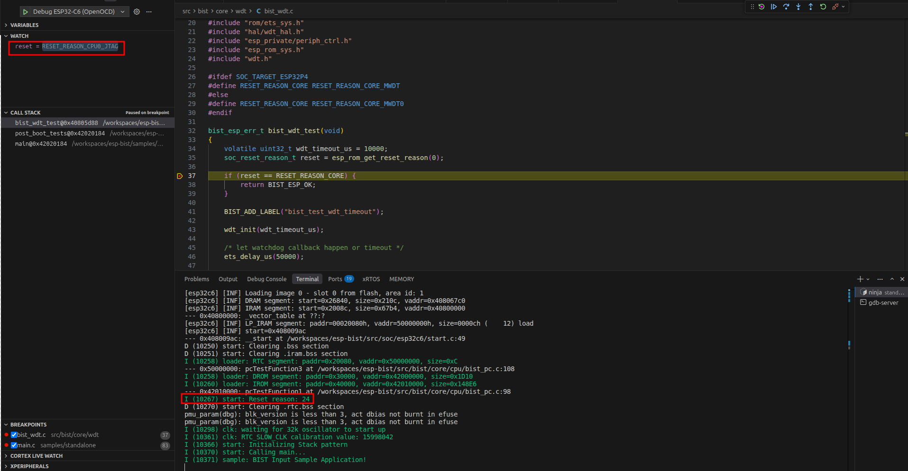

   Debugger breakpoint showing reset reason check (RESET_REASON_CPU0_JTAG)

- Screenshot showing reset reason log after reboot (see :numref:`fig-wdt-2`):

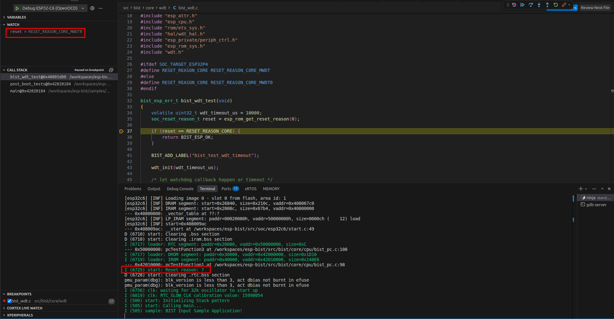

   Serial output after reboot showing ``reset reason: 7 (RESET_REASON_CORE_MWDT0)``

.. raw:: latex

   \clearpage

Test 2: External Crystal Test
-----------------------------

**Purpose:** Verify the external crystal test behavior on SoCs without hardware XT WDT support (the XT WDT hardware monitor mechanism itself was validated on ESP32-C3 in the ESP-BIST v1.0.0 Witness Test Report).

**Test Component:** External 32.768 kHz Crystal Oscillator / XT WDT Fallback Mechanism

Successful Run
^^^^^^^^^^^^^^

**Description:**

The external crystal test (``bist_ext_crystal_fail_test()``) verifies external low-speed crystal integrity. On SoCs featuring a dedicated XT WDT peripheral (such as the ESP32-C3, as validated in the ESP-BIST v1.0.0 Witness Test Report), the test registers a failure callback and validates oscillator activity. Because the ESP32-C6 SoC does not incorporate an XT WDT peripheral (``SOC_XT_WDT_SUPPORTED`` is 0), ``bist_ext_crystal_fail_test()`` logs an informational notice that SoCs without XT WDT have no dedicated hardware mechanism to detect 32 kHz crystal failure and returns ``BIST_ESP_OK``.

**Execution Steps:**

1. Application calls ``bist_ext_crystal_fail_test()``
2. Library inspects hardware capability configuration (``SOC_XT_WDT_SUPPORTED`` is 0)
3. Library emits debug log indicating test skip on this target
4. Function returns ``BIST_ESP_OK`` without error

**Expected Behavior:**

- Test executes cleanly without triggering hardware faults
- Return value is ``BIST_ESP_OK``
- Application proceeds to subsequent post-boot tests

**Evidence:**

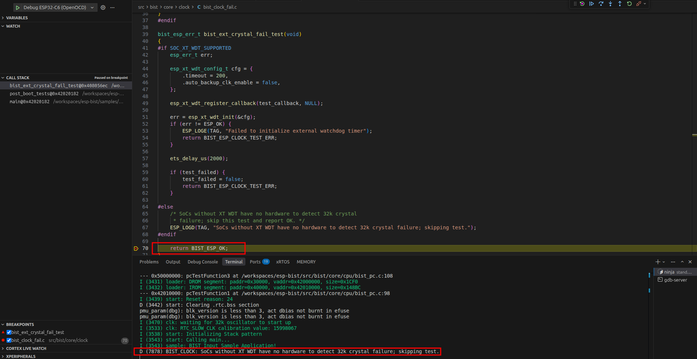

   Debugger breakpoint showing external crystal test execution

Test 3: Main Crystal Test
--------------------------

**Purpose:** Verify that the main 40MHz crystal oscillator is operating within specified frequency tolerances.

**Test Component:** Main 40MHz Crystal Oscillator (referenced to fitted 32.768 kHz crystal)

Successful Run
^^^^^^^^^^^^^^

**Description:**

The main crystal test (``bist_main_crystal_test()``) validates the 40MHz main crystal oscillator by measuring its frequency ratio against the 32.768 kHz external crystal reference using ``rtc_clk_cal(CLK_CAL_32K_XTAL, 500)`` and verifying that frequency deviation remains within the configured threshold (default: ±1%).

**Execution Steps:**

1. Application calls ``bist_main_crystal_test()``
2. Test retrieves expected crystal frequency via ``rtc_clk_xtal_freq_get()``
3. Measures frequency ratio between main oscillator and 32.768 kHz reference
4. Calculates deviation percentage: ``|measured - expected| / expected * 100``
5. Checks if deviation exceeds ``CONFIG_ESP_BIST_CLOCK_PERCENT_FREQUENCY_DRIFT`` (±1%)
6. Returns ``BIST_ESP_OK`` if within tolerance

**Expected Behavior:**

- Frequency calibration against 32.768 kHz reference completes successfully
- Measured frequency matches expected value within ±1%
- Test returns ``BIST_ESP_OK``, confirming crystal functionality

**Evidence:**

- Screenshot showing successful main crystal test

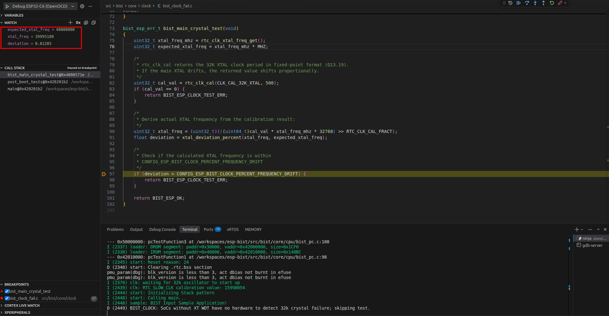

   Main crystal test successful

Error Injection
^^^^^^^^^^^^^^^

Error Injection Scenario 1: Remove External 32kHz Crystal
~~~~~~~~~~~~~~~~~~~~~~~~~~~~~~~~~~~~~~~~~~~~~~~~~~~~~~~~~

**Injection Method:**

The error is injected by physically disconnecting the external 32.768 kHz crystal from headers GPIO0 and GPIO1, removing the frequency measurement reference.

**Injected Fault:**

External 32.768 kHz reference crystal absent, causing ``rtc_clk_cal()`` to return 0.

**Execution Steps:**

1. Physically remove or disconnect the external 32.768 kHz crystal from GPIO0/GPIO1
2. Application calls ``bist_main_crystal_test()``
3. Frequency measurement detects absent clock reference (cal_val == 0)
4. Test detects reference failure and returns ``BIST_ESP_CLOCK_TEST_ERR`` (error code 6)

**Expected Behavior:**

- Frequency measurement fails due to missing 32 kHz reference
- Test detects failure and returns error code ``BIST_ESP_CLOCK_TEST_ERR``
- Application enters fail-safe handler

**Evidence Collection:**

**Error Injection Evidence:**

- Physical evidence of 32.768 kHz crystal removal from headers
- Debugger state showing ``cal_val`` evaluating to 0

**Error Detection Evidence:**

- Serial log showing clock calibration failure
- Error return code ``BIST_ESP_CLOCK_TEST_ERR`` (6)

**System Response Evidence:**

- Test correctly returns ``BIST_ESP_CLOCK_TEST_ERR``
- Fail-safe exit is triggered as expected

**Screenshots/Logs:**

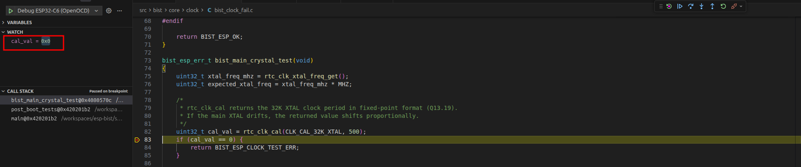

   Debugger breakpoint showing main crystal ``cal_val`` failure.

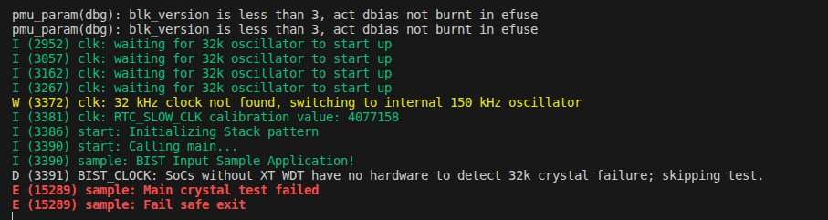

   Serial output showing main crystal test failure

Error Injection Scenario 2: Modify Deviation Threshold
~~~~~~~~~~~~~~~~~~~~~~~~~~~~~~~~~~~~~~~~~~~~~~~~~~~~~~~~

**Injection Method:**

The error is injected via JTAG by modifying the measured frequency ratio or deviation variable during test execution to exceed the 1% threshold.

**Injected Fault:**

Deviation value modified to exceed 1% (e.g., 2%), forcing a frequency out-of-bounds condition.

**Execution Steps:**

1. Connect JTAG debugger and set breakpoint at deviation threshold comparison
2. Application calls ``bist_main_crystal_test()``
3. When breakpoint hits, modify calculated deviation variable to 2% via JTAG
4. Test evaluates deviation against configured threshold
5. Test detects deviation exceeds threshold and returns ``BIST_ESP_CLOCK_TEST_ERR``

**Expected Behavior:**

- Deviation modification successfully applied via JTAG
- Test detects threshold violation and returns error code ``BIST_ESP_CLOCK_TEST_ERR``
- System responds appropriately to detected failure

**Evidence Collection:**

**Error Injection Evidence:**

- Debugger inspection showing altered deviation value

**Error Detection Evidence:**

- Serial log showing frequency deviation error
- Test returns error code 6

**System Response Evidence:**

- Test correctly returns ``BIST_ESP_CLOCK_TEST_ERR``
- Fail-safe exit is triggered as expected

**Screenshots/Logs:**

- Screenshot showing debugger modification of deviation value (see :numref:`fig-main-crystal-f3`):

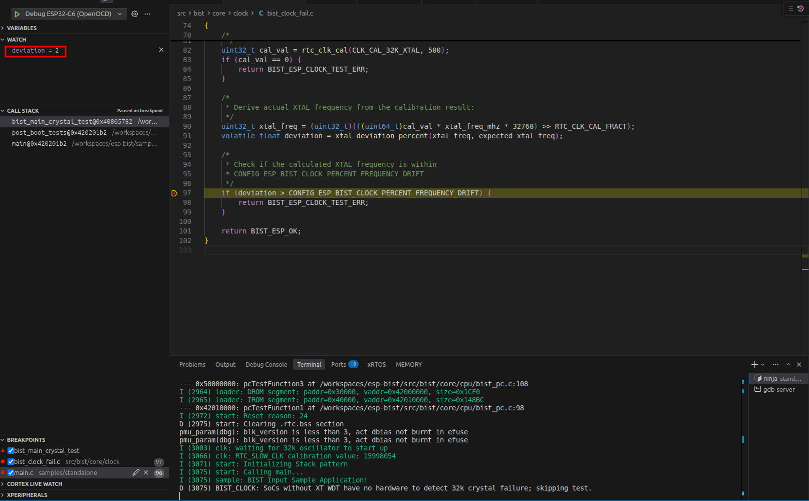

   Debugger modification of deviation value

- Screenshot showing serial output showing main crystal test failure (see :numref:`fig-main-crystal-f4`):

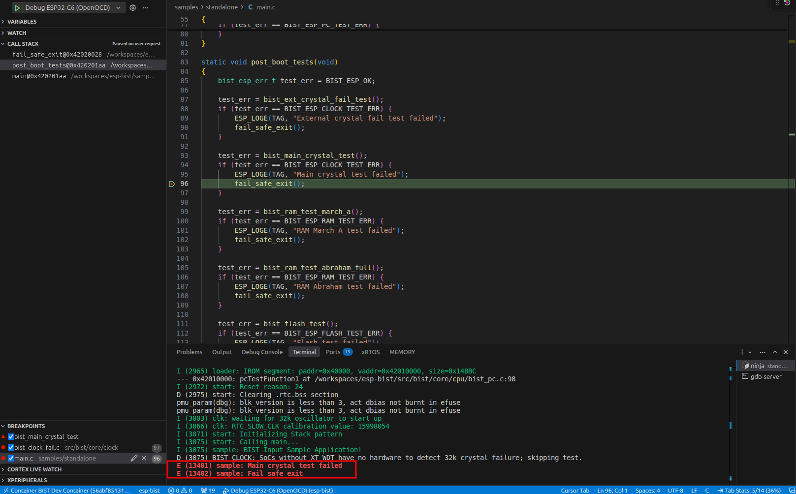

   Serial output showing main crystal test failure

.. raw:: latex

   \clearpage

Test 4: RAM Integrity Test (March A)
------------------------------------

**Purpose:** Verify that RAM can store and retrieve test patterns reliably, detecting address faults, stuck-at faults, and coupling faults using the March A algorithm.

**Test Component:** RAM (Volatile Memory)

Successful Run
^^^^^^^^^^^^^^

**Description:**

The RAM test (``bist_ram_test_march_a()``) validates RAM integrity across the linker-defined memory region using the March A algorithm. The test executes progressive write and read operations across memory, backing up each memory chunk into a dedicated buffer and restoring it upon verification.

**Execution Steps:**

1. Application calls ``bist_ram_test_march_a()`` during post-boot tests
2. Test executes March A algorithm over linker-defined RAM region
3. Backup/restore chunk buffer preserves existing memory content
4. Returns ``BIST_ESP_OK`` if all patterns are verified

**Expected Behavior:**

- March A algorithm completes successfully across all memory chunks
- All RAM patterns verified correctly without data corruption
- Original memory content is preserved
- Test returns ``BIST_ESP_OK``

**Evidence:**

- Screenshot showing successful March A RAM test (see :numref:`fig-ram-ok`):

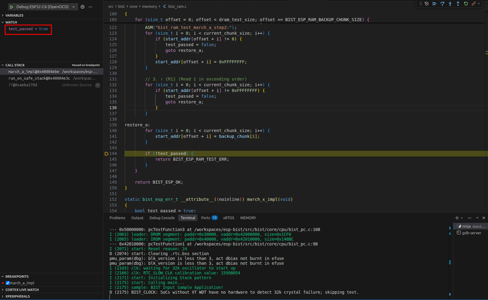

   March A RAM test successful

Error Injection
^^^^^^^^^^^^^^^

**Injection Method:**

Memory corruption is injected via JTAG by modifying RAM contents within a chunk during active March A verification.

**Injected Fault:**

RAM word overwritten with inverted pattern during readback phase.

**Execution Steps:**

1. Connect JTAG debugger and set breakpoint inside March A verification loop
2. Application calls ``bist_ram_test_march_a()``
3. When breakpoint hits, modify memory word to incorrect value via JTAG
4. Test continues and reads memory location, expecting original pattern
5. Pattern mismatch detected, test restores backup buffer and returns ``BIST_ESP_RAM_TEST_ERR`` (3)

**Expected Behavior:**

- Memory corruption is successfully injected via JTAG
- Test detects pattern mismatch
- Test restores corrupted RAM content from backup chunk
- Test returns error code ``BIST_ESP_RAM_TEST_ERR``
- System responds appropriately to detected failure

Evidence Collection
^^^^^^^^^^^^^^^^^^^

**Error Injection Evidence:**

- Debugger state showing modified memory word address and value

**Error Detection Evidence:**

- Serial log showing RAM test pattern mismatch
- Error return code ``BIST_ESP_RAM_TEST_ERR``

**System Response Evidence:**

- Test correctly returns ``BIST_ESP_RAM_TEST_ERR``
- Memory buffer restored from backup
- Fail-safe exit is triggered as expected

**Screenshots/Logs:**

- Screenshot showing memory modification during step 2 of March A algorithm (see :numref:`fig-ram-f1`):

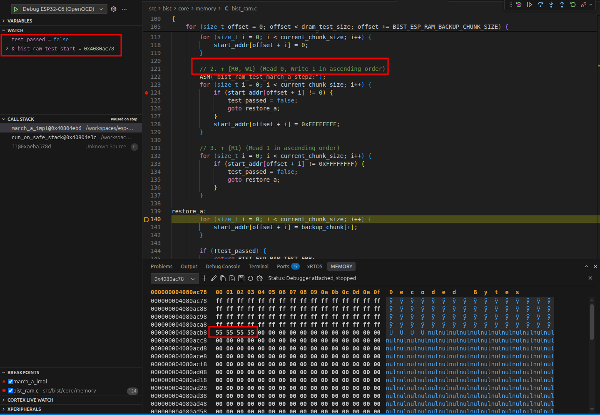

   Memory modification during step 2 of March A algorithm

- Test restores corrupted RAM content from backup chunk (see :numref:`fig-ram-restore`):

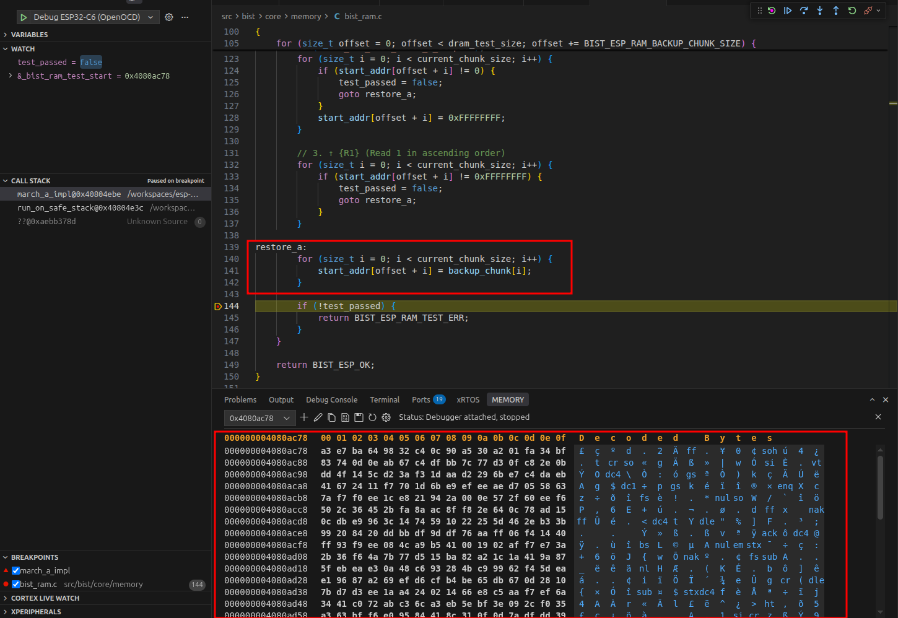

   March A RAM test restores corrupted RAM content from backup chunk

- Screenshot showing serial output showing March A RAM test failure (see :numref:`fig-ram-f2`):

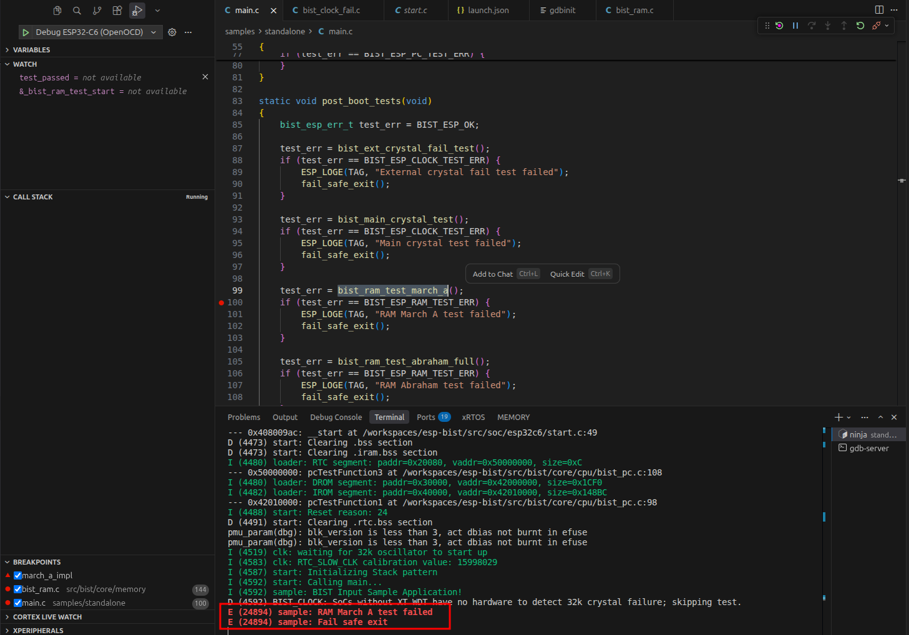

   Serial output showing March A RAM test failure

.. raw:: latex

   \clearpage

Test 5: Abraham RAM Test
------------------------

**Purpose:** Verify that RAM can store and retrieve test patterns reliably under the comprehensive Abraham algorithm in accordance with IEC 60730 Annex H.2.19.1.

**Test Component:** RAM (Volatile Memory, Abraham Full March)

Successful Run
^^^^^^^^^^^^^^

**Description:**

The Abraham RAM test (``bist_ram_test_abraham_full()``) validates RAM integrity across the linker-defined memory region using the comprehensive Abraham algorithm. The algorithm divides the memory space into partition pairs and executes exhaustive multi-step read and write sequences to detect pattern-sensitive faults, coupling faults, and address decoder faults. Memory chunks are backed up prior to testing and restored upon completion. The test executes post-boot following the March A test.

**Execution Steps:**

1. Application calls ``bist_ram_test_abraham_full()`` during post-boot tests
2. Test partitions the memory space into balanced partition pairs
3. Executes Abraham march sequences across active partition pairs
4. Dedicated backup buffer preserves memory contents during verification
5. Returns ``BIST_ESP_OK`` if all patterns across all partition pairs match

**Expected Behavior:**

- Abraham march executes completely across all partition pairs
- All readback patterns match expected values
- Memory contents are restored from backup buffer
- Test returns ``BIST_ESP_OK``

**Evidence:**

- Screenshot showing successful Abraham RAM test (see :numref:`fig-abraham-ok`):

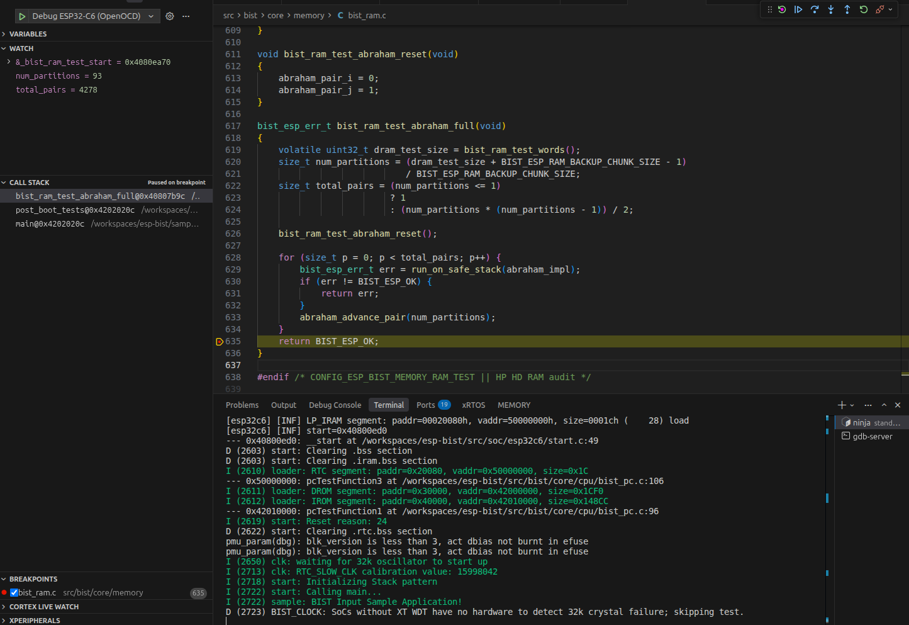

   Abraham RAM test successful

Error Injection
^^^^^^^^^^^^^^^

**Injection Method:**

Memory corruption is injected via JTAG by modifying a RAM word within an active partition pair during Abraham march execution.

**Injected Fault:**

Target memory word overwritten with corrupted value during readback phase.

**Execution Steps:**

1. Connect JTAG debugger and set breakpoint within Abraham march verification loop
2. Application calls ``bist_ram_test_abraham_full()``
3. When breakpoint hits, modify target RAM word to incorrect pattern via JTAG
4. Test resumes and encounters mismatch between read value and expected Abraham pattern
5. Test restores memory buffer from backup and returns ``BIST_ESP_RAM_TEST_ERR`` (error code 3)

**Expected Behavior:**

- Memory pattern corrupted via JTAG
- Mismatch detected by Abraham verification logic
- Memory chunk restored from backup
- Test returns error code ``BIST_ESP_RAM_TEST_ERR``
- System responds appropriately to detected failure

Evidence Collection
^^^^^^^^^^^^^^^^^^^

**Error Injection Evidence:**

- Debugger inspection showing modified memory address and value

**Error Detection Evidence:**

- Serial log indicating Abraham RAM test pattern mismatch
- Return code evaluates to ``BIST_ESP_RAM_TEST_ERR``

**System Response Evidence:**

- Test correctly returns ``BIST_ESP_RAM_TEST_ERR``
- Fail-safe exit is triggered as expected

**Screenshots/Logs:**

- Screenshot showing memory modification during Abraham march execution (see :numref:`fig-abraham-f1`):

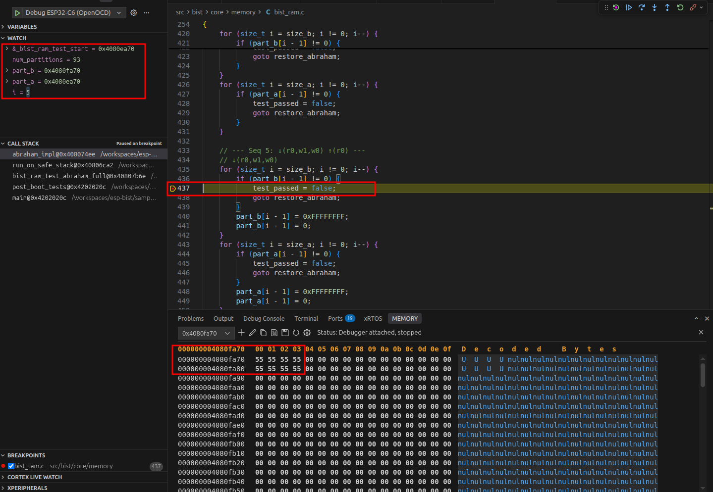

   Memory modification during Abraham march execution

- Screenshot showing returning error code from Abraham RAM test (see :numref:`fig-abraham-f2`):

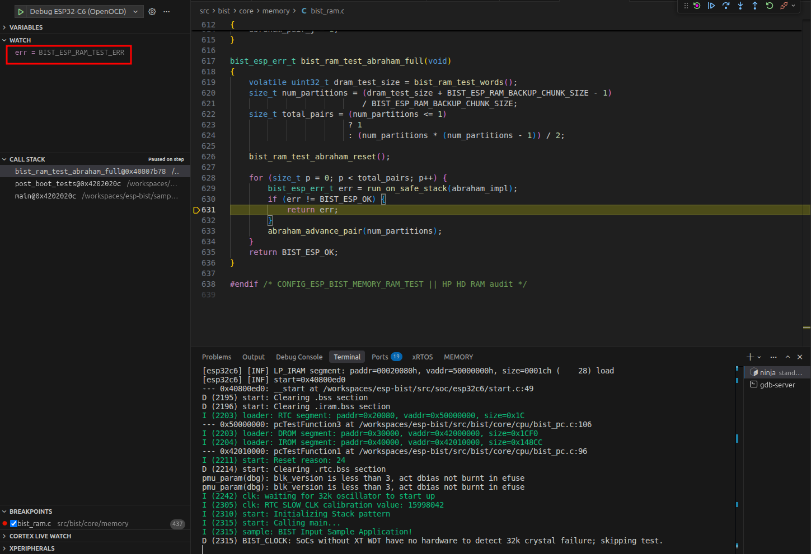

   Returning error code from Abraham RAM test

- Screenshot showing error log from Abraham RAM test (see :numref:`fig-abraham-f3`):

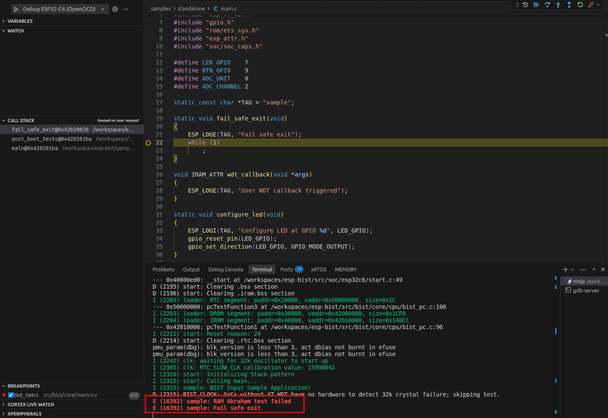

   Error log from Abraham RAM test

.. raw:: latex

   \clearpage

Test 6: Flash CRC Validation Test
---------------------------------

**Purpose:** Verify that flash code and data sections have not been corrupted or tampered with since firmware build time using CRC32 checksums.

**Test Component:** Flash Memory (Non-volatile Memory: ``.flash.text`` and ``.flash.rodata``)

Successful Run
^^^^^^^^^^^^^^

**Description:**

The flash test (``bist_flash_test()``) validates flash memory integrity by computing CRC32 checksums over the ``.flash.text`` and ``.flash.rodata`` sections and comparing them against post-build injected CRC reference values.

**Execution Steps:**

1. Application calls ``bist_flash_test()``
2. Test reads post-build injected CRC reference values from flash
3. Computes CRC32 over ``.flash.text`` section in chunks (1024 bytes default)
4. Compares computed CRC against stored reference value
5. Repeats CRC32 computation and comparison for ``.flash.rodata`` section
6. Returns ``BIST_ESP_OK`` if both CRCs match

**Expected Behavior:**

- CRC computation completes successfully
- Both ``.flash.text`` and ``.flash.rodata`` checksums match reference values
- Test returns ``BIST_ESP_OK``, confirming flash integrity

**Evidence:**

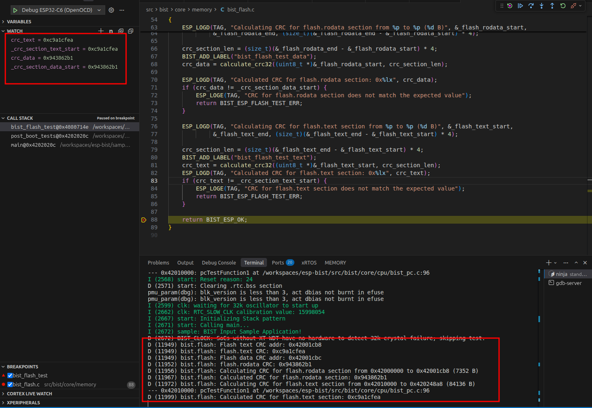

   Flash CRC validation test successful

Error Injection
^^^^^^^^^^^^^^^

**Injection Method:**

Flash verification corruption is injected via JTAG by modifying the calculated ``crc_data`` variable during data section verification.

**Injected Fault:**

The ``crc_data`` variable is modified to an incorrect checksum value during ``.flash.rodata`` verification.

**Execution Steps:**

1. Connect JTAG debugger and set breakpoint at CRC data section verification
2. Application calls ``bist_flash_test()``
3. Test validates text section (``.flash.text``) - passes
4. Test commences data section validation (``.flash.rodata``)
5. When breakpoint hits, modify ``crc_data`` variable to incorrect value via JTAG
6. Test compares modified ``crc_data`` against stored CRC reference
7. Checksum mismatch detected for data section
8. Test returns ``BIST_ESP_FLASH_TEST_ERR`` (error code 4)

**Expected Behavior:**

- Variable ``crc_data`` successfully altered via JTAG
- Text section validation passes; data section validation fails due to mismatch
- Test returns error code ``BIST_ESP_FLASH_TEST_ERR``
- System triggers fail-safe handler

Evidence Collection
^^^^^^^^^^^^^^^^^^^

**Error Injection Evidence:**

- Debugger inspection showing altered ``crc_data`` register/memory value

**Error Detection Evidence:**

- Serial log showing flash CRC verification mismatch
- Return code evaluates to ``BIST_ESP_FLASH_TEST_ERR``

**System Response Evidence:**

- Test correctly returns ``BIST_ESP_FLASH_TEST_ERR``
- Fail-safe exit is triggered as expected

**Screenshots/Logs:**

- Screenshot showing debugger modification of ``crc_text`` variable (see :numref:`fig-flash-fail`):

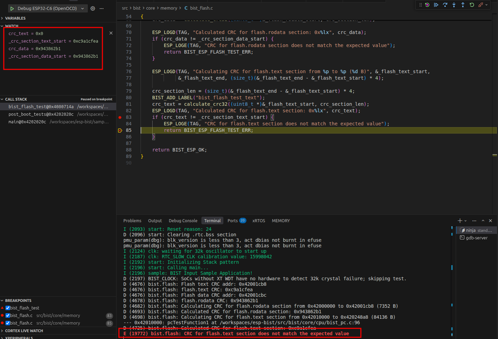

   Flash CRC validation test failure

- Screenshot showing serial output showing flash CRC validation test failure (see :numref:`fig-flash-fail-log`):

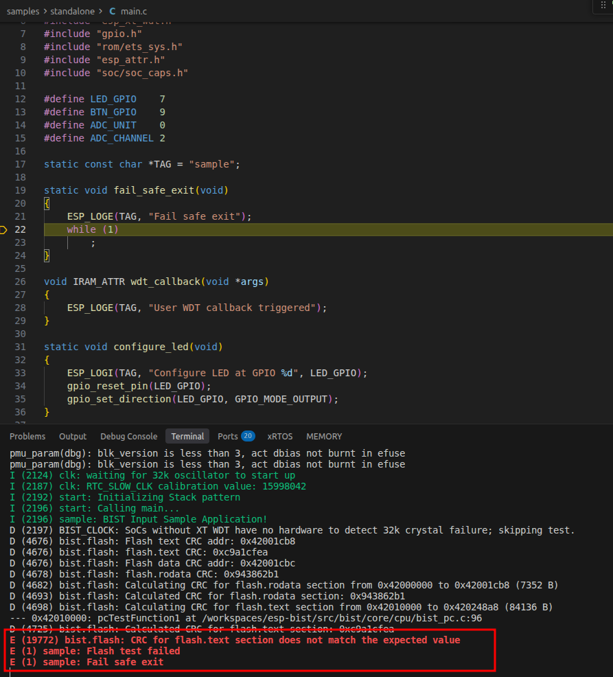

   Serial output showing flash CRC validation test failure

Test 7: Stack Overflow Detection Test
--------------------------------------

**Purpose:** Detect and report stack overflow conditions that could corrupt memory or cause undefined behavior.

**Test Component:** CPU Stack

Successful Run
^^^^^^^^^^^^^^

**Description:**

The stack overflow test (``bist_cpu_stack_overflow_test()``) validates stack protection by populating the guard region between ``_stack_overflow_protection_end`` and ``_stack_overflow_protection_start`` with a sentinel pattern (``STACK_PROTECTION_PATTERN`` = 0xDEADBEEF). Intentional deep recursion forces stack frames to grow downward into the protection zone. When the sentinel is overwritten, ``bist_cpu_stack_overflow_check()`` detects the corruption and returns ``BIST_ESP_STACK_TEST_OVERFLOW``, causing the test function to return ``BIST_ESP_OK`` to confirm the detection mechanism is operational.

**Execution Steps:**

1. Application calls ``bist_cpu_stack_overflow_test()``
2. Test initializes sentinel pattern (0xDEADBEEF) across the entire protection boundary
3. Intentional deep recursion with 128-byte stack frames executes (count_max = 20000)
4. Recursive frames force stack downward and overwrite sentinel word
5. Test detects sentinel corruption via ``bist_cpu_stack_overflow_check()``
6. Returns ``BIST_ESP_OK``, confirming stack protection is operational

**Expected Behavior:**

- Stack growth correctly reaches and alters the protection region
- Sentinel pattern corruption is detected immediately
- Overflow detection mechanism confirmed operational
- Test returns ``BIST_ESP_OK``

**Evidence:**

- Screenshot showing successful stack overflow initialization (see :numref:`fig-stack-init`):

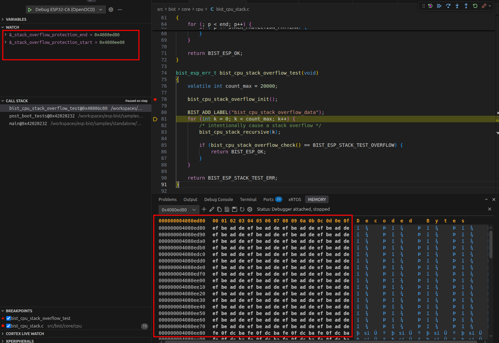

   Stack overflow initialization

- Screenshot showing successful stack overflow detection test (see :numref:`fig-stack-ok`):

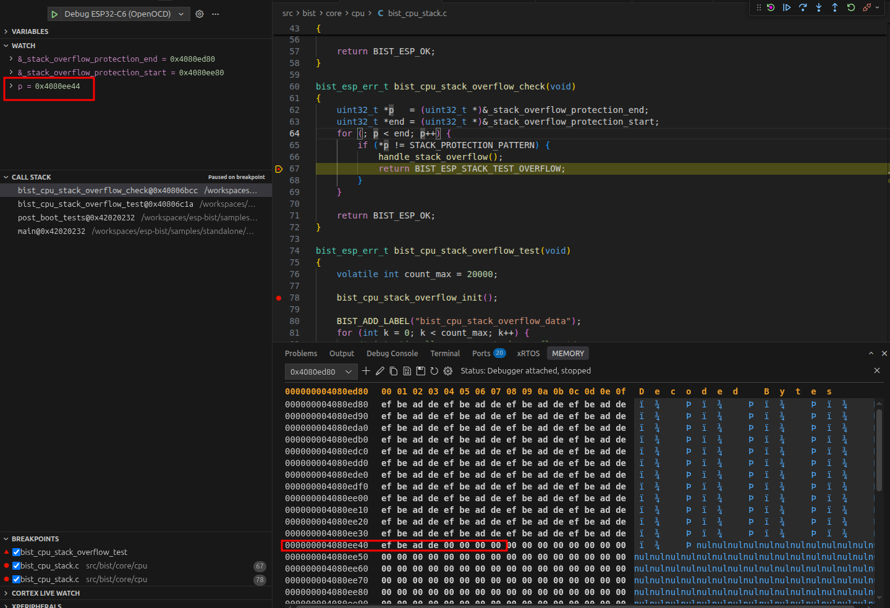

   Stack overflow detection test successful

Error Injection
^^^^^^^^^^^^^^^

**Injection Method:**

Stack overflow detection is bypassed by modifying the recursion limit or stack frame variables via JTAG so the recursion depth cannot reach the sentinel boundary.

**Injected Fault:**

Recursion depth parameter modified to 10 via JTAG, preventing the stack from reaching the sentinel region.

**Execution Steps:**

1. Connect JTAG debugger and set breakpoint at recursive function entry
2. Application calls ``bist_cpu_stack_overflow_test()``
3. When breakpoint hits, reduce recursion loop counter to 10 via JTAG
4. Recursion terminates without reaching the protection zone
5. Sentinel remains uncorrupted; overflow detection fails to trigger
6. Function exhausts loop without detecting overflow and returns ``BIST_ESP_STACK_TEST_ERR`` (7)

**Expected Behavior:**

- Recursion depth truncated via JTAG
- Test cannot reach protection zone
- Test returns error code ``BIST_ESP_STACK_TEST_ERR``
- System responds appropriately to detected failure

Evidence Collection
^^^^^^^^^^^^^^^^^^^

**Error Injection Evidence:**

- Debugger inspection showing altered recursion counter

**Error Detection Evidence:**

- Serial log indicating stack overflow was not detected within loop limit
- Return code evaluates to ``BIST_ESP_STACK_TEST_ERR``

**System Response Evidence:**

- Test correctly returns ``BIST_ESP_STACK_TEST_ERR``
- Fail-safe exit is triggered as expected

**Screenshots/Logs:**

- Screenshot showing debugger modification of recursion counter (see :numref:`fig-stack-fail`):

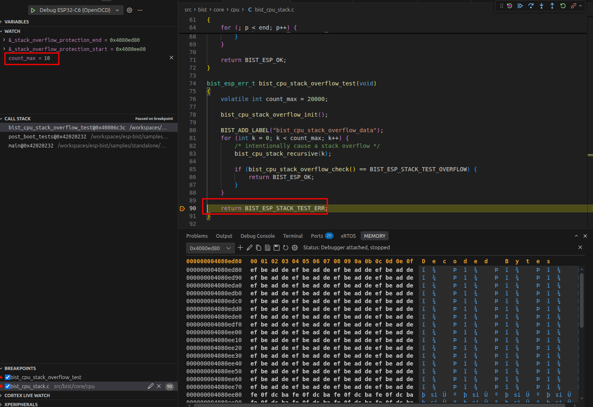

   Debugger modification of recursion counter

.. raw:: latex

   \clearpage

Test 8: GPIO Output Test
-------------------------

**Purpose:** Verify that GPIO pins can be configured as outputs and that output levels are controllable and readable.

**Test Component:** GPIO7 (External LED; GPIO8 RGB LED left unassigned)

Successful Run
^^^^^^^^^^^^^^

**Description:**

The GPIO output test (``bist_gpio_output_test()``) validates GPIO output functionality by configuring the pin in input/output mode, driving both 0 and 1 digital levels, and reading back each level to verify correct electrical state. GPIO7 connects to an external LED matching the standalone sample configuration.

**Execution Steps:**

1. Application calls ``bist_gpio_output_test(LED_GPIO)`` where LED_GPIO = 7
2. Test configures GPIO7 as bi-directional output (``GPIO_MODE_INPUT_OUTPUT``)
3. Drives level 0, reads back pad status, verifies level 0
4. Drives level 1, reads back pad status, verifies level 1
5. Restores GPIO to default reset state
6. Returns ``BIST_ESP_OK`` if both levels match driven state

**Expected Behavior:**

- GPIO output configuration succeeds
- Driven levels 0 and 1 are correctly read back
- Test returns ``BIST_ESP_OK``, confirming GPIO output functionality

**Evidence:**

- Screenshot showing successful GPIO output test (see :numref:`fig-gpio-out-ok`):

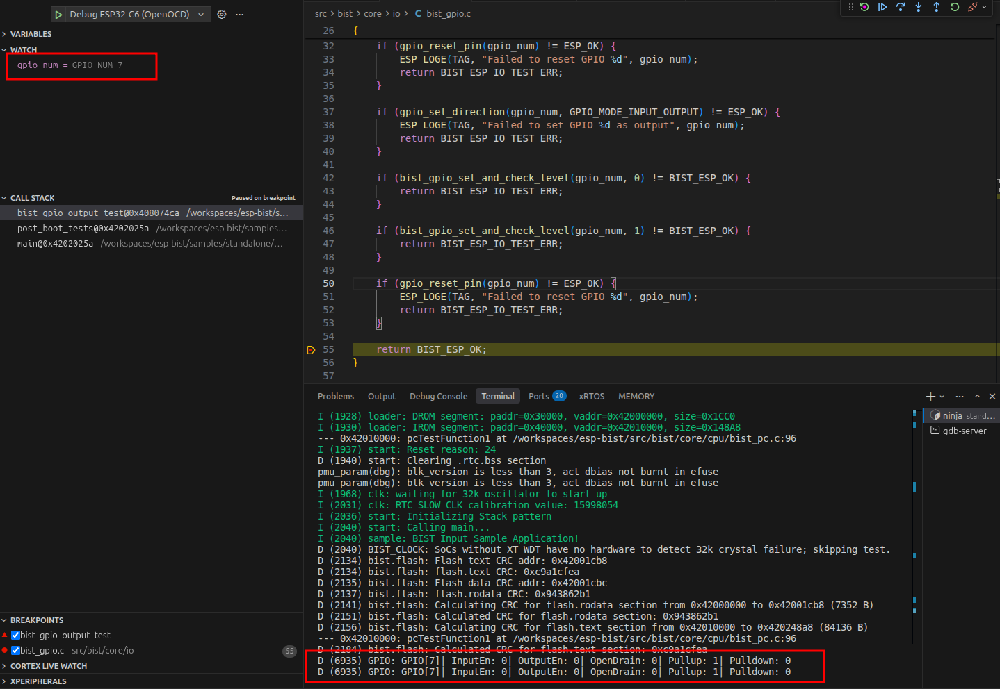

   GPIO output test successful

Error Injection
^^^^^^^^^^^^^^^

**Injection Method:**

GPIO output failure is injected via JTAG by modifying the readback variable or GPIO register status during level verification.

**Injected Fault:**

GPIO level read register altered via JTAG to report inverted level during verification.

**Execution Steps:**

1. Connect JTAG debugger and set breakpoint at GPIO readback verification
2. Application calls ``bist_gpio_output_test(LED_GPIO)``
3. Pin is driven to level 1
4. When breakpoint hits, force readback register or variable to level 0 via JTAG
5. Mismatch detected between driven level and readback level
6. Test returns ``BIST_ESP_IO_TEST_ERR`` (error code 10)

**Expected Behavior:**

- Register value modified via JTAG
- Level mismatch detected by test logic
- Test returns error code ``BIST_ESP_IO_TEST_ERR``
- System responds appropriately to detected failure

Evidence Collection
^^^^^^^^^^^^^^^^^^^

**Error Injection Evidence:**

- Debugger inspection showing forced GPIO read value

**Error Detection Evidence:**

- Serial log indicating GPIO output verification mismatch
- Return code evaluates to ``BIST_ESP_IO_TEST_ERR``

**System Response Evidence:**

- Test correctly returns ``BIST_ESP_IO_TEST_ERR``
- Fail-safe exit is triggered as expected

**Screenshots/Logs:**

- Screenshot showing debugger modification of GPIO readback value (see :numref:`fig-gpio-out-fail`):

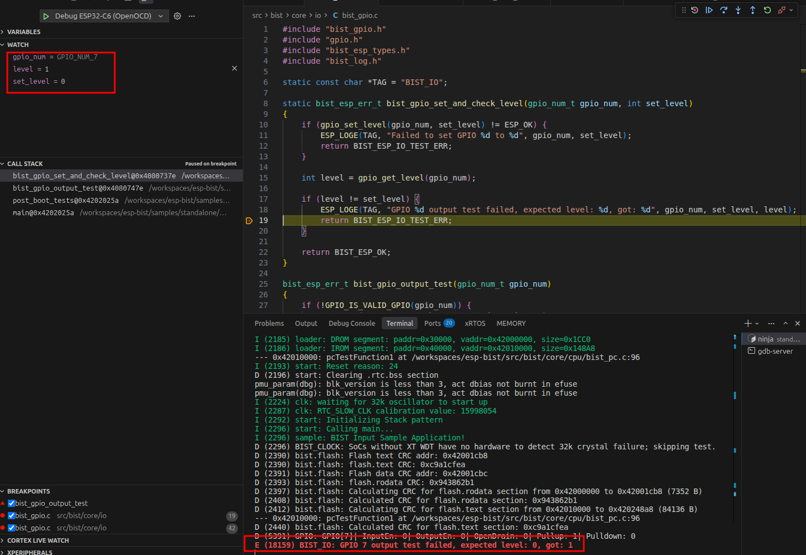

   Debugger modification of GPIO readback value

.. raw:: latex

   \clearpage

Test 9: GPIO Input Test
------------------------

**Purpose:** Verify that GPIO pins can be configured as inputs and that input levels are readable correctly.

**Test Component:** GPIO9 (Built-in Boot Button, idle high)

Successful Run
^^^^^^^^^^^^^^

**Description:**

The GPIO input test (``bist_gpio_input_test()``) validates GPIO input functionality by configuring a designated pin as input and verifying that the sampled level matches the expected state. GPIO9 connects to the built-in Boot button, which is pulled up to VDD (expected idle level = 1). Because GPIO9 serves as a chip strapping pin during power-on reset, this test executes post-boot with the button released.

**Execution Steps:**

1. Application calls ``bist_gpio_input_test(BTN_GPIO, 1)`` where BTN_GPIO = 9
2. Test configures GPIO9 as input (``GPIO_MODE_INPUT``)
3. Button is released (idle level = 1)
4. Reads GPIO level and verifies it matches expected value 1
5. Resets GPIO configuration to default state
6. Returns ``BIST_ESP_OK`` if level matches expected value

**Expected Behavior:**

- GPIO input configuration succeeds
- Input level is correctly read as 1
- Test returns ``BIST_ESP_OK``, confirming GPIO input functionality

**Evidence:**

- Screenshot showing successful GPIO input test (see :numref:`fig-gpio-in-ok`):

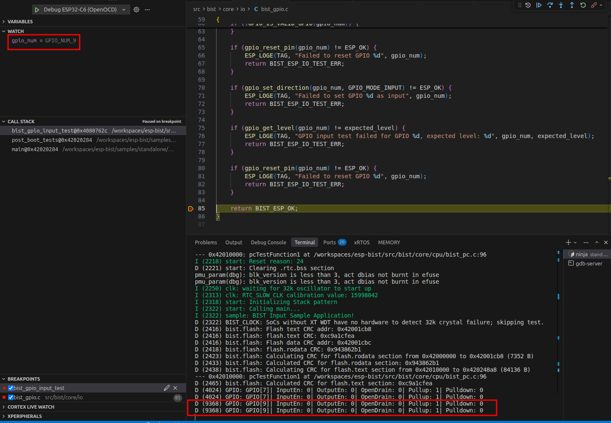

   GPIO input test successful

Error Injection
^^^^^^^^^^^^^^^

**Injection Method:**

GPIO input failure is injected by physically pressing the Boot button (forcing GPIO9 to ground/0) during test execution, or by altering the input register via JTAG.

**Injected Fault:**

GPIO input forced to level 0 (GND) when expected level is 1.

**Execution Steps:**

1. Press and hold the built-in Boot button (GPIO9), or set JTAG breakpoint and force input register to 0
2. Application calls ``bist_gpio_input_test(BTN_GPIO, 1)``
3. Test reads GPIO level and detects level 0 instead of expected 1
4. Mismatch detected, test returns ``BIST_ESP_IO_TEST_ERR`` (error code 10)

**Expected Behavior:**

- Physical button press or JTAG manipulation forces pin to level 0
- Level mismatch detected by test logic
- Test returns error code ``BIST_ESP_IO_TEST_ERR``
- System responds appropriately to detected failure

Evidence Collection
^^^^^^^^^^^^^^^^^^^

**Error Injection Evidence:**

- Physical button held down, or debugger inspection showing GPIO input register bit cleared

**Error Detection Evidence:**

- Serial log indicating GPIO input level mismatch (expected 1, got 0)
- Return code evaluates to ``BIST_ESP_IO_TEST_ERR``

**System Response Evidence:**

- Test correctly returns ``BIST_ESP_IO_TEST_ERR``
- Fail-safe exit is triggered as expected

**Screenshots/Logs:**

- Screenshot showing GPIO input failure (see :numref:`fig-gpio-in-fail`):

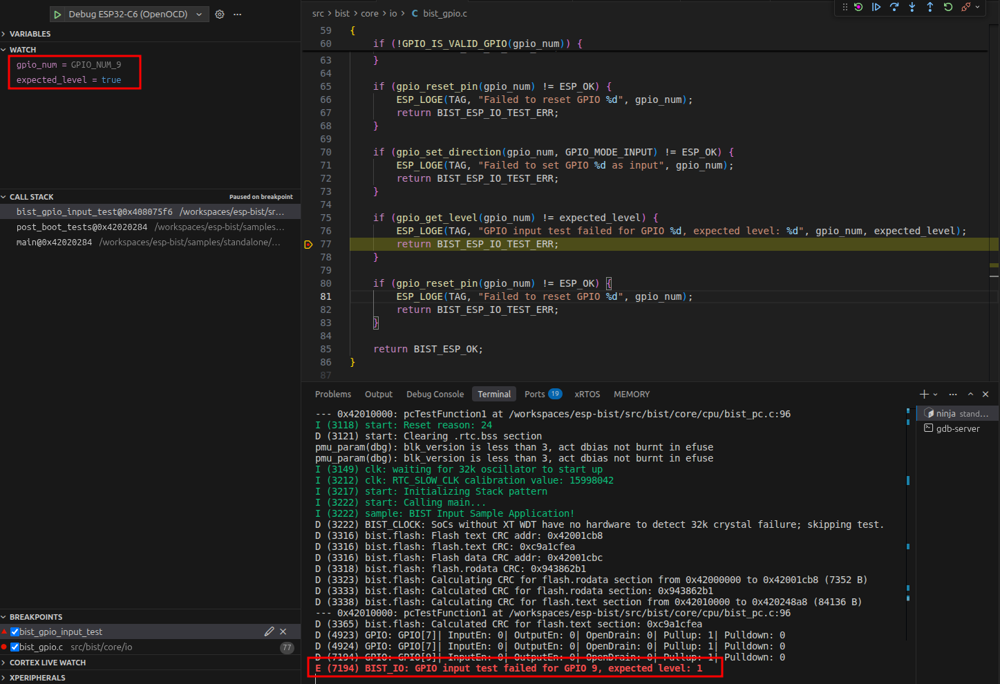

   GPIO input failure

.. raw:: latex

   \clearpage

Test 10: ADC Input Validation Test
----------------------------------

**Purpose:** Verify that the Analog-to-Digital Converter (ADC1) accurately samples external voltages and distinguishes low (ground) and high (reference) input levels.

**Test Component:** ADC1 Channel 2 (GPIO2)

Successful Run
^^^^^^^^^^^^^^

**Description:**

The ADC test validates that ADC1 Channel 2 correctly reads low and high voltage levels within calibrated bounds. On the ESP32-C6-DevKitC-1, ADC1 Channel 2 maps to GPIO2. The standalone application executes a low-level check (GND applied, raw reading near 0) and a high-level check (VDD applied, raw reading approximately 3248). The internal reference test is exclusive to ESP32-C3 and is not applicable to ESP32-C6.

**Execution Steps:**

1. Application calls ADC validation functions for ADC1 Channel 2 (GPIO2)
2. Sample ADC raw value with low input applied (GND); verify raw reading is within low threshold (0)
3. Sample ADC raw value with high input applied (VDD); verify raw reading is within high threshold (~3248)
4. Returns ``BIST_ESP_OK`` if both measurements satisfy configured limits

**Expected Behavior:**

- Low-level voltage correctly sampled below low threshold
- High-level voltage correctly sampled above high threshold
- Test returns ``BIST_ESP_OK``, confirming ADC sampling accuracy

**Evidence:**

- Screenshot showing successful ADC low-level validation test (see :numref:`fig-adc-low-ok`):

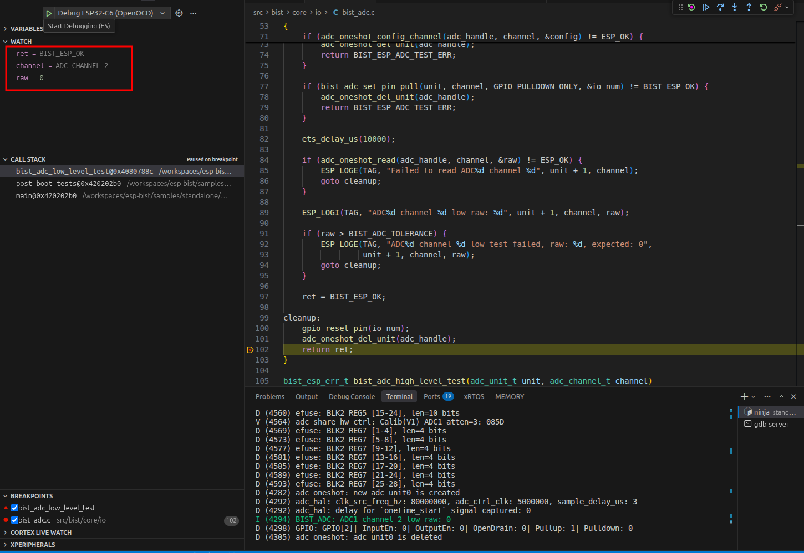

   ADC low-level validation test successful

- Screenshot showing successful ADC high-level validation test (see :numref:`fig-adc-high-ok`):

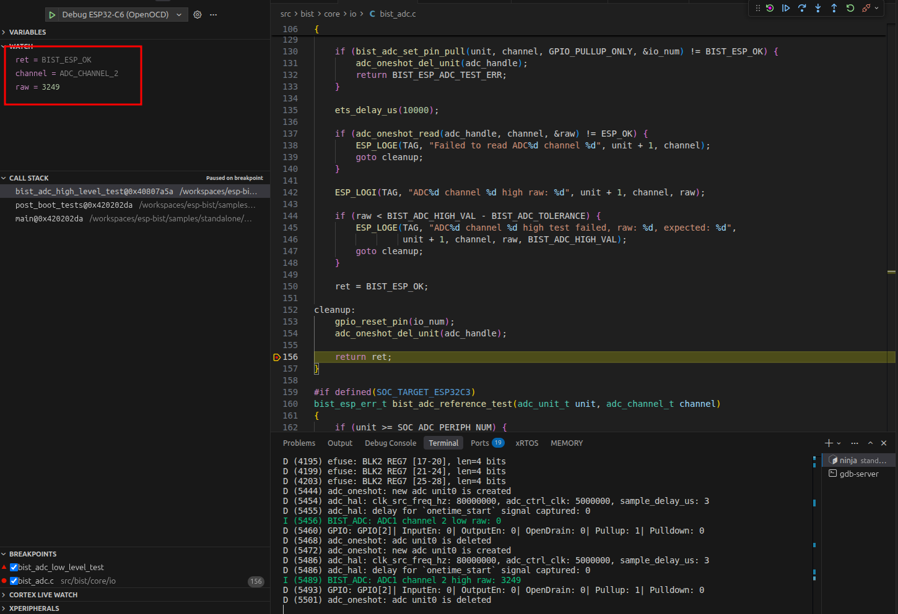

   ADC high-level validation test successful

Error Injection
^^^^^^^^^^^^^^^

**Injection Method:**

ADC sampling fault is injected by connecting the ADC input pin (GPIO2) to the wrong reference voltage (connecting to VDD when low level is expected, and connecting to GND when high level is expected).

**Injected Fault:**

- Low-level test: GPIO2 connected to VDD (3.3 V) instead of GND, causing sampled raw reading (~2480) to exceed the low-level tolerance threshold (expected: 0).
- High-level test: GPIO2 connected to GND instead of VDD, causing sampled raw reading (~720) to fall below the high-level minimum threshold (expected: 3350).

**Execution Steps:**

1. Connect GPIO2 to VDD (3.3 V)
2. Application calls ``bist_adc_low_level_test(ADC_UNIT_1, ADC_CHANNEL_2)``
3. ADC samples GPIO2 and reads raw value ~2480 (violating the expected 0 threshold)
4. Test evaluates reading against low-level limit, detects violation, and returns ``BIST_ESP_ADC_TEST_ERR``
5. Connect GPIO2 to GND
6. Application calls ``bist_adc_high_level_test(ADC_UNIT_1, ADC_CHANNEL_2)``
7. ADC samples GPIO2 and reads raw value ~720 (violating the expected ~3350 threshold)
8. Test evaluates reading against high-level limit, detects violation, and returns ``BIST_ESP_ADC_TEST_ERR``

**Expected Behavior:**

- Inverted voltage levels violate configured thresholds for each test phase
- ``bist_adc_low_level_test()`` fails with ``BIST_ESP_ADC_TEST_ERR`` (raw reading exceeds low threshold)
- ``bist_adc_high_level_test()`` fails with ``BIST_ESP_ADC_TEST_ERR`` (raw reading below high threshold)
- System responds appropriately to detected failure

Evidence Collection
^^^^^^^^^^^^^^^^^^^

**Error Injection Evidence:**

- Physical connection of GPIO2 to VDD during low-level test and to GND during high-level test
- Debugger inspection showing out-of-bounds sampled raw values (raw = 2480 for low test, raw = 720 for high test)

**Error Detection Evidence:**

- Serial log output indicating ADC test failures
- Return code evaluates to ``BIST_ESP_ADC_TEST_ERR``

**System Response Evidence:**

- Both functions return error code ``BIST_ESP_ADC_TEST_ERR``
- Application fail-safe handler is triggered

**Screenshots/Logs:**

- Screenshot showing ADC low-level test failure with GPIO2 connected to VDD (see :numref:`fig-adc-low-fail`):

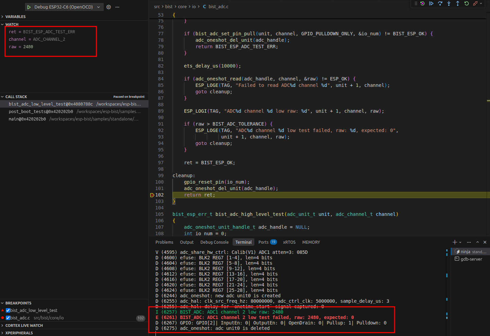

   ADC low-level test failure with GPIO2 connected to VDD

- Screenshot showing ADC high-level test failure with GPIO2 connected to GND (see :numref:`fig-adc-high-fail`):

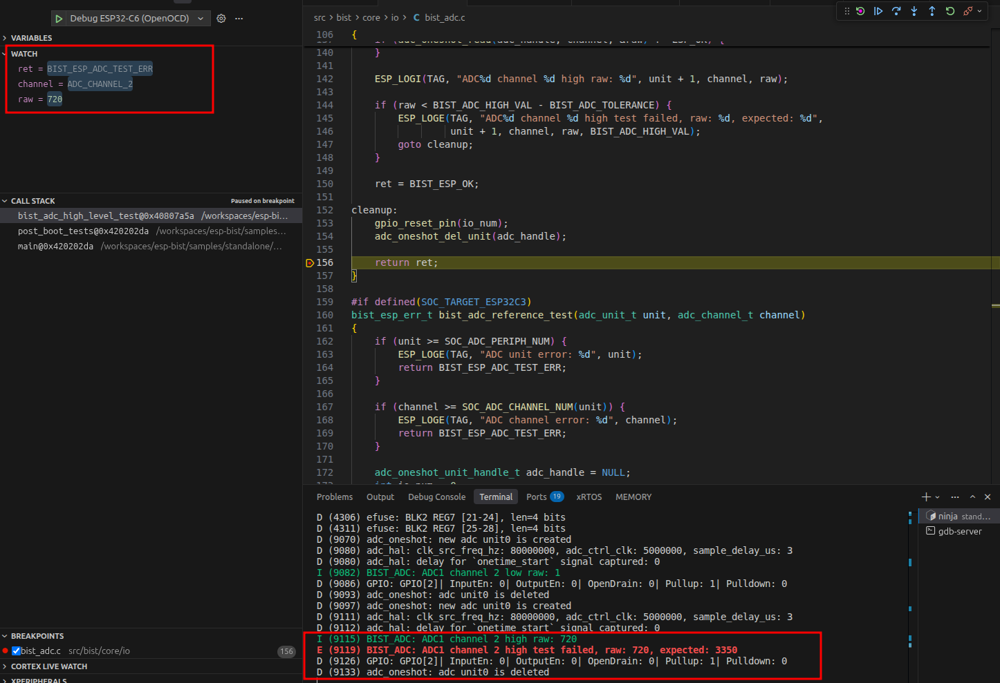

   ADC high-level test failure with GPIO2 connected to GND

.. raw:: latex

   \clearpage

Test 11: Software Interrupt Source Map Test
-------------------------------------------

**Purpose:** Verify that CPU software interrupt sources can be dynamically routed through the interrupt matrix, triggered, and unmapped without interference.

**Test Component:** Interrupt Matrix and CPU Software Interrupt Lines (``CPU_INTR_FROM_CPU_0`` through ``CPU_INTR_FROM_CPU_3``)

Successful Run
^^^^^^^^^^^^^^

**Description:**

The software interrupt test (``bist_interrupt_source_map_test()``) validates the interrupt matrix routing for software IRQ sources. The four available software interrupt sources (``CPU_INTR_FROM_CPU_0`` through ``CPU_INTR_FROM_CPU_3``) are routed in succession to an unreserved CPU interrupt line (CPU interrupt 9). For each source, the interrupt is triggered 8 times (``BIST_INTERRUPT_LOOP_COUNT``) via register writes, the CPU interrupt enable mask is verified, the ISR delivery count is verified, and the source is unmapped.

**Execution Steps:**

1. Application calls ``bist_interrupt_source_map_test()`` during post-boot tests
2. For each of the four software interrupt sources:
   a. Route source to CPU interrupt line 9 using ``esp_rom_route_intr_matrix()``
   b. Register ISR handler and enable CPU interrupt 9
   c. Trigger interrupt 8 times via writes to ``INTPRI_CPU_INTR_FROM_CPU_x_REG``
   d. Verify CPU interrupt enable mask confirms bit 9 is set
   e. Disable CPU interrupt 9 and unmap source in matrix
   f. Verify CPU interrupt enable mask confirms bit 9 is cleared
   g. Verify ISR delivery counter equals 8
3. Returns ``BIST_ESP_OK`` if all four sources map, trigger, and unmap correctly

**Expected Behavior:**

- All four software interrupt sources route and fire reliably
- CPU interrupt enable masks match expected enabled and disabled states
- ISR execution count exactly equals 8 triggers per source
- Test returns ``BIST_ESP_OK``

**Evidence:**

- Screenshot showing successful software interrupt source map test (see :numref:`fig-irq-sw-ok`):

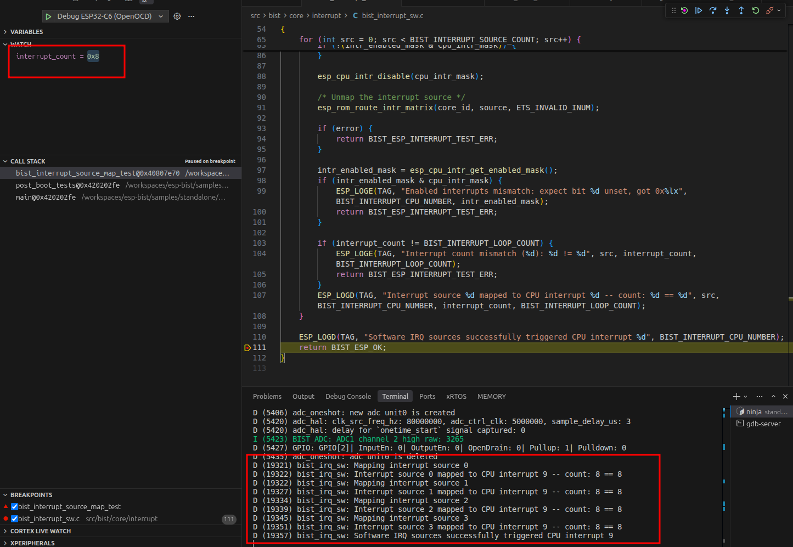

   Software interrupt source map test successful

Error Injection
^^^^^^^^^^^^^^^

**Injection Method:**

Interrupt delivery failure is injected via JTAG by modifying the ISR delivery counter or clearing the CPU interrupt enable mask during test execution.

**Injected Fault:**

Interrupt counter altered via JTAG to value != 8 (e.g. 7), simulating missed interrupt delivery.

**Execution Steps:**

1. Connect JTAG debugger and set breakpoint at ``bist_interrupt_source_map_count`` label
2. Application calls ``bist_interrupt_source_map_test()``
3. When breakpoint hits, alter ``interrupt_count`` variable to 7 via JTAG
4. Test evaluates delivery count against expected trigger count (8)
5. Mismatch detected, test returns ``BIST_ESP_INTERRUPT_TEST_ERR`` (error code 12)

**Expected Behavior:**

- Counter value altered via JTAG
- Test detects interrupt delivery count mismatch
- Test returns error code ``BIST_ESP_INTERRUPT_TEST_ERR``
- System responds appropriately to detected failure

Evidence Collection
^^^^^^^^^^^^^^^^^^^

**Error Injection Evidence:**

- Debugger state showing altered interrupt counter variable

**Error Detection Evidence:**

- Serial log indicating software interrupt count mismatch
- Return code evaluates to ``BIST_ESP_INTERRUPT_TEST_ERR``

**System Response Evidence:**

- Test correctly returns ``BIST_ESP_INTERRUPT_TEST_ERR``
- Fail-safe exit is triggered as expected

**Screenshots/Logs:**

- Screenshot showing software interrupt source map test failure (see :numref:`fig-irq-sw-fail`):

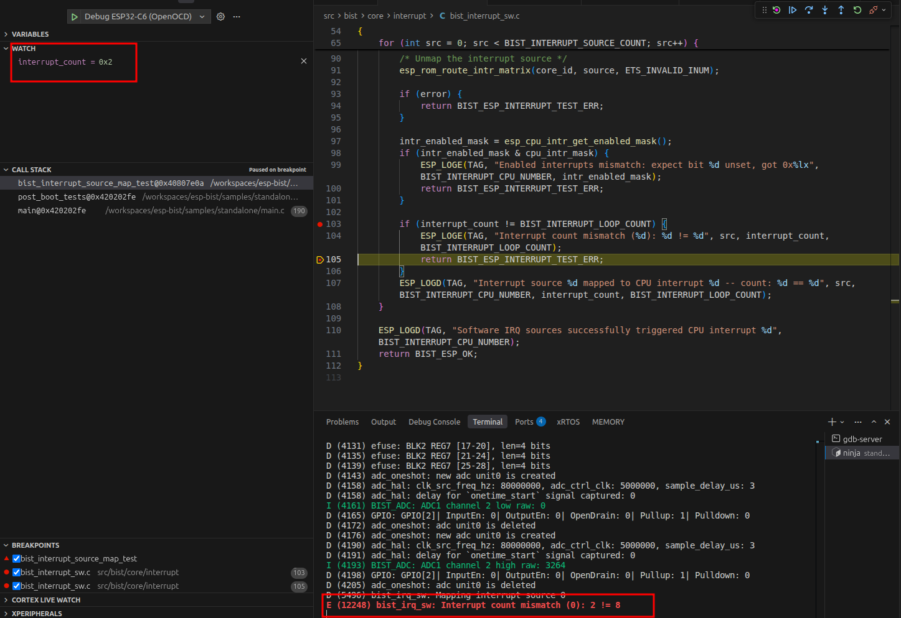

   Software interrupt source map test failure

.. raw:: latex

   \clearpage

Test 14: Hardware Timer Interrupt Test
--------------------------------------

**Purpose:** Verify concurrent hardware interrupt delivery and timing fidelity using dual General Purpose Timers across different timer groups.

**Test Component:** Hardware Timer Groups (TIMG0 and TIMG1, GPTimer alarms)

Successful Run
^^^^^^^^^^^^^^

**Description:**

The hardware interrupt test (``bist_hardware_interrupt_test()``) validates concurrent interrupt handling using two distinct timer groups. Timer Group 0 Timer 0 is configured with a 500 µs alarm period, and Timer Group 1 Timer 0 is configured with a 1000 µs alarm period. Both timers route to independent CPU interrupt lines. Because the alarm periods maintain a 2:1 ratio, Timer 0 fires twice as often as Timer 1. The test verifies that the ratio of ISR deliveries satisfies ``abs(count_1 - 2 * count_2) <= 1``, allowing a tolerance of one count for synchronization skew.

**Execution Steps:**

1. Application calls ``bist_hardware_interrupt_test()`` during post-boot tests
2. Initialize TIMG0 Timer 0 with 500 µs alarm period and attach ISR handler
3. Initialize TIMG1 Timer 0 with 1000 µs alarm period and attach ISR handler
4. Enable both timers concurrently
5. In each ISR, acknowledge alarm, re-arm timer, and increment respective counter
6. Check counter ratio periodically: ``abs(count_1 - 2 * count_2) <= 1``
7. Allow execution until counter target is reached (1000 deliveries)
8. Stop timers, release interrupt resources, and return ``BIST_ESP_OK``

**Expected Behavior:**

- Both hardware timers fire concurrently across TIMG0 and TIMG1
- Counter ratio stays within 2:1 ratio (±1 tolerance) throughout execution
- Test returns ``BIST_ESP_OK``, confirming dual-timer interrupt integrity

**Evidence:**

- Screenshot showing successful hardware timer interrupt test (see :numref:`fig-irq-hw-ok`):

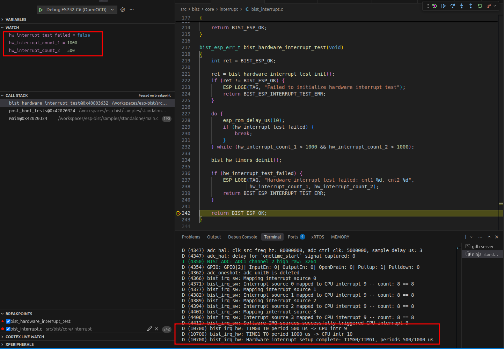

   Hardware timer interrupt test successful

Error Injection
^^^^^^^^^^^^^^^

**Injection Method:**

Hardware timing fault is injected via JTAG by modifying the alarm period of Timer 1 to match Timer 0, altering the delivery frequency from 2:1 to 1:1.

**Injected Fault:**

TIMG1 alarm reload value modified from 1000 µs to 500 µs via JTAG, skewing the expected ratio.

**Execution Steps:**

1. Connect JTAG debugger and set breakpoint at timer initialization
2. Application calls ``bist_hardware_interrupt_test()``
3. When breakpoint hits, alter TIMG1 alarm reload value to 500 µs via JTAG
4. Timers execute with identical periods, firing at 1:1 ratio
5. Test evaluates ratio equation; difference between counts exceeds tolerance of 1
6. Test detects ratio failure and returns ``BIST_ESP_INTERRUPT_TEST_ERR`` (error code 12)

**Expected Behavior:**

- Timer period altered via JTAG
- Ratio evaluation detects timing discrepancy
- Test returns error code ``BIST_ESP_INTERRUPT_TEST_ERR``
- System responds appropriately to detected failure

Evidence Collection
^^^^^^^^^^^^^^^^^^^

**Error Injection Evidence:**

- Debugger inspection showing altered timer alarm register values

**Error Detection Evidence:**

- Serial log indicating timer ratio verification failure
- Return code evaluates to ``BIST_ESP_INTERRUPT_TEST_ERR``

**System Response Evidence:**

- Test correctly returns ``BIST_ESP_INTERRUPT_TEST_ERR``
- Fail-safe exit is triggered as expected

**Screenshots/Logs:**

- Screenshot showing hardware timer interrupt test failure (see :numref:`fig-irq-hw-fail`):

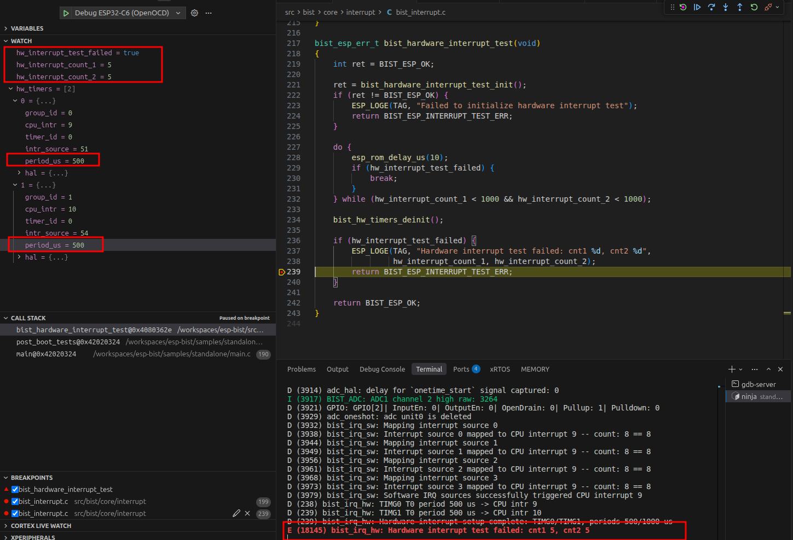

   Hardware timer interrupt test failure

.. raw:: latex

   \clearpage

Test 11: CPU Register Integrity Test
-------------------------------------

**Purpose:** Verify that all CPU general-purpose registers maintain integrity and can retain both 0 and 1 patterns without corruption.

**Test Component:** CPU General-Purpose Registers (integer registers X1-X31)

Successful Run
^^^^^^^^^^^^^^

**Description:**

The CPU register test (``bist_cpu_regs_test()``) validates all 31 integer general-purpose registers by writing alternating checkerboard bit patterns (0xAAAAAAAA and 0x55555555) to each register and verifying they can be read back without corruption. The ESP32-C6 core does not include a hardware floating-point unit (FPU), so floating-point registers ``f0`` to ``f31`` are not present on this target and are not included in the test.

**Execution Steps:**

1. Application calls ``bist_cpu_regs_test()`` during runtime tests
2. Test writes 0xAAAAAAAA to each register X1-X31, reads back, and compares
3. Test writes 0x55555555 to each register X1-X31, reads back, and compares
4. Returns ``BIST_ESP_OK`` and logs successful verification

**Expected Behavior:**

- All 31 integer registers pass integrity checks
- Both test patterns (0xAAAAAAAA and 0x55555555) are verified
- No stuck-at faults or register corruption detected
- Test returns ``BIST_ESP_OK``

**Evidence:**

- Screenshot showing successful CPU register integrity test (see :numref:`fig-cpu-regs-ok`):

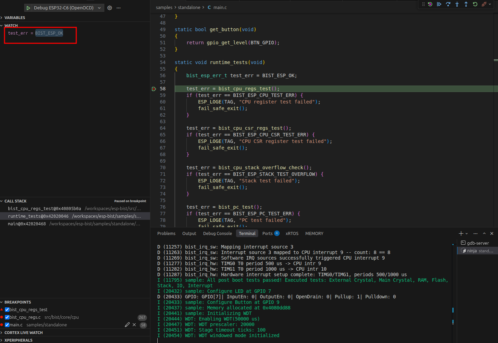

   CPU register integrity test successful

.. raw:: latex

   \clearpage

Error Injection
^^^^^^^^^^^^^^^

**Injection Method:**

Register corruption is injected via JTAG by modifying a target register value during test execution.

**Injected Fault:**

Register value corrupted to wrong pattern (0x55555555 when expecting 0xAAAAAAAA) during verification.

**Execution Steps:**

1. Connect JTAG debugger and set breakpoint at register test label (e.g. ``testRegA_s0``)
2. Application calls ``bist_cpu_regs_test()`` during runtime tests
3. When breakpoint hits, modify target register to inverted pattern via JTAG
4. Test resumes and reads register, expecting 0xAAAAAAAA
5. Mismatch detected, returns error code ``BIST_ESP_CPU_TEST_ERR`` (error code 1)
6. Test logs register test failure

**Expected Behavior:**

- Register corruption successfully injected via JTAG
- Test detects pattern mismatch
- Test returns error code ``BIST_ESP_CPU_TEST_ERR``
- System responds appropriately to detected failure

Evidence Collection
^^^^^^^^^^^^^^^^^^^

**Error Injection Evidence:**

- Debugger state showing target register value modified

**Error Detection Evidence:**

- Serial log indicating CPU register test failure
- Return code evaluates to ``BIST_ESP_CPU_TEST_ERR``

**System Response Evidence:**

- Test correctly returns ``BIST_ESP_CPU_TEST_ERR``
- Fail-safe exit is triggered as expected

**Screenshots/Logs:**

- Screenshot showing CPU register integrity test failure (see :numref:`fig-cpu-regs-fail`):

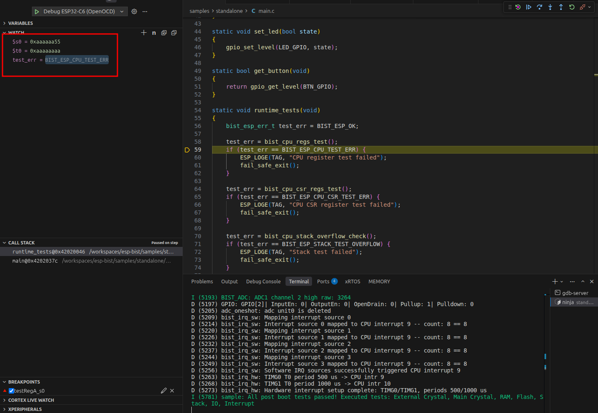

   CPU register integrity test failure

- Screenshot showing log of CPU register integrity test failure (see :numref:`fig-cpu-regs-fail-log`):

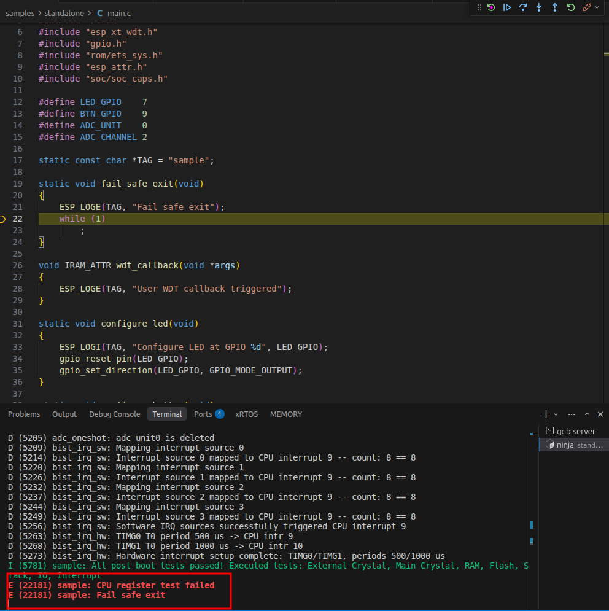

   CPU register integrity test failure log

.. raw:: latex

   \clearpage

Test 10: CPU CSR Integrity Test
---------------------------------

**Purpose:** Verify that CPU Control and Status Registers (CSRs), including Physical Memory Protection (PMP) and Physical Memory Attribute (PMA) address registers, maintain integrity and can be read and written reliably.

**Test Component:** CPU Control and Status Registers (CSRs: MTVEC, MSCRATCH, MEPC, MCAUSE, MTVAL, PMPADDR0-PMPADDR15, and PMA address registers 0xBD0-0xBDA)

Successful Run
^^^^^^^^^^^^^^

**Description:**

The CPU CSR test (``bist_cpu_csr_regs_test()``) validates the readable and writable Machine-mode CSRs. On the ESP32-C6, the test exercises standard trap handling CSRs, 16 PMP address registers, and 11 PMA address registers (CSRs 0xBD0 through 0xBDA, covering PMA entries 0 to 11 with mask ``0x3FFFFFE0``). For each register, original values are saved, checkerboard patterns (0xAAAAAAAA and 0x55555555 masked by register-specific writable bitmasks) are written and verified, and original values are restored. Because the ESP32-C6 core has no FPU, floating-point CSRs (``fflags``, ``frm``, ``fcsr``) are not tested.

**Execution Steps:**

1. Application calls ``bist_cpu_csr_regs_test()`` during runtime tests
2. For each CSR:
   a. Save original register value to stack
   b. Write 0xAAAAAAAA masked by CSR-specific mask, read back, and compare
   c. Write 0x55555555 masked by CSR-specific mask, read back, and compare
   d. Restore original register value
3. Returns ``BIST_ESP_OK`` if all CSRs pass verification

**Expected Behavior:**

- All verified CSRs (including PMP and PMA address registers) pass integrity checks
- Both test patterns verified correctly
- Original register values restored
- Test returns ``BIST_ESP_OK``

**Evidence:**

- Screenshot showing successful CPU CSR integrity test (see :numref:`fig-cpu-csr-ok`):

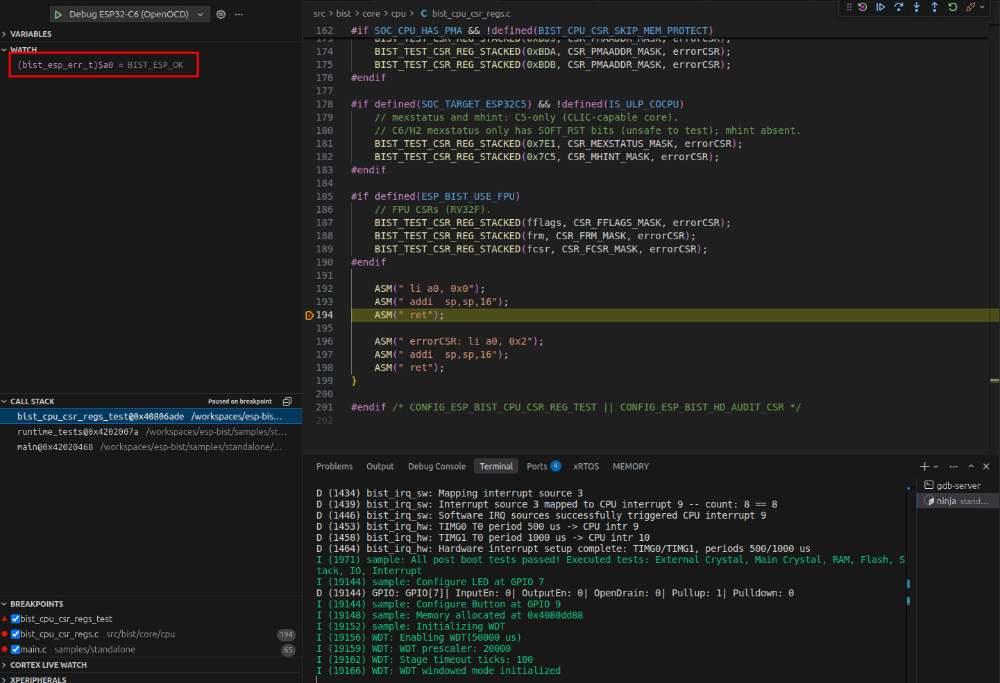

   CPU CSR integrity test successful

.. raw:: latex

   \clearpage

Error Injection
^^^^^^^^^^^^^^^

**Injection Method:**

CSR verification failure is injected via JTAG by modifying the temporary comparison register or CSR value during pattern verification.

**Injected Fault:**

Temporary register or CSR value corrupted during pattern comparison (e.g. at a PMA address register).

**Execution Steps:**

1. Connect JTAG debugger and set breakpoint at CSR test comparison
2. Application calls ``bist_cpu_csr_regs_test()`` during runtime tests
3. When breakpoint hits, alter temporary comparison register or target CSR value via JTAG
4. Test detects pattern mismatch and returns ``BIST_ESP_CPU_CSR_TEST_ERR`` (error code 2)

**Expected Behavior:**

- Register value corrupted via JTAG
- Test detects CSR verification mismatch
- Test returns error code ``BIST_ESP_CPU_CSR_TEST_ERR``
- System responds appropriately to detected failure

Evidence Collection
^^^^^^^^^^^^^^^^^^^

**Error Injection Evidence:**

- Debugger inspection showing corrupted register value during CSR verification

**Error Detection Evidence:**

- Serial log indicating CPU CSR test failure
- Return code evaluates to ``BIST_ESP_CPU_CSR_TEST_ERR``

**System Response Evidence:**

- Test correctly returns ``BIST_ESP_CPU_CSR_TEST_ERR``
- Fail-safe exit is triggered as expected

**Screenshots/Logs:**

- Screenshot showing CPU CSR integrity test failure (see :numref:`fig-cpu-csr-fail`):

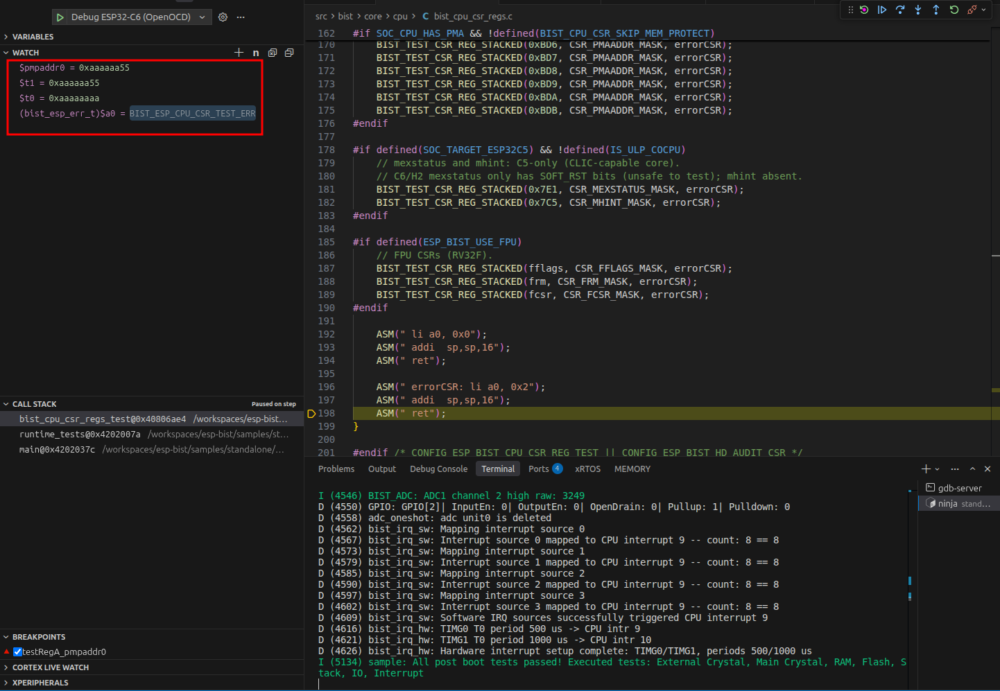

   CPU CSR integrity test failure

- Screenshot showing log of CPU CSR integrity test failure (see :numref:`fig-cpu-csr-fail-log`):

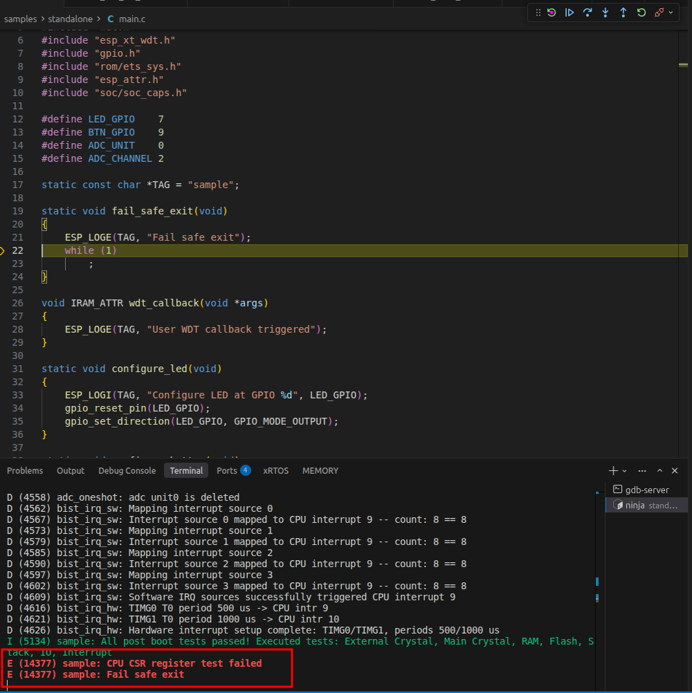

   CPU CSR integrity test failure log

.. raw:: latex

   \clearpage

Test 11: Program Counter Integrity Test
-----------------------------------------

**Purpose:** Verify that the program counter maintains integrity and that code execution occurs in expected memory regions (IRAM, Flash, RTC).

**Test Component:** Program Counter (PC) across four distinct memory regions

Successful Run
^^^^^^^^^^^^^^

**Description:**

The program counter test (``bist_pc_test()``) validates PC integrity by executing four functions located across different physical memory regions and verifying that their return addresses match expected function entry points. The ESP32-C6 has no tightly-coupled memory (TCM), so four functions are tested (``pcTestFunction0`` through ``pcTestFunction3``). Two functions reside in IRAM (exercising opposite address bit states), one resides in flash, and one resides in RTC fast memory, collectively exercising 24 distinct PC bits.

**Execution Steps:**

1. Application calls ``bist_pc_test()`` during runtime tests
2. Test invokes four regional functions:
   - ``pcTestFunction0`` @ IRAM (0x4038xxxx)
   - ``pcTestFunction1`` @ IRAM (0x403Bxxxx, bits 2-15 inverted)
   - ``pcTestFunction2`` @ Flash (0x4201xxxx, bits 19, 20, 21, 25)
   - ``pcTestFunction3`` @ RTC (0x5000xxxx, bit 28)
3. Each function returns its own entry address
4. Test verifies returned address against expected function symbol
5. Returns ``BIST_ESP_OK`` if all addresses match

**Expected Behavior:**

- All four function entry points verified correctly
- 24 PC bits (2-17, 19-21, 25, 28) exercised successfully
- No unexpected code execution or address corruption detected
- Test returns ``BIST_ESP_OK``

**Evidence:**

- Screenshot showing successful program counter integrity test (see :numref:`fig-pc-ok`):

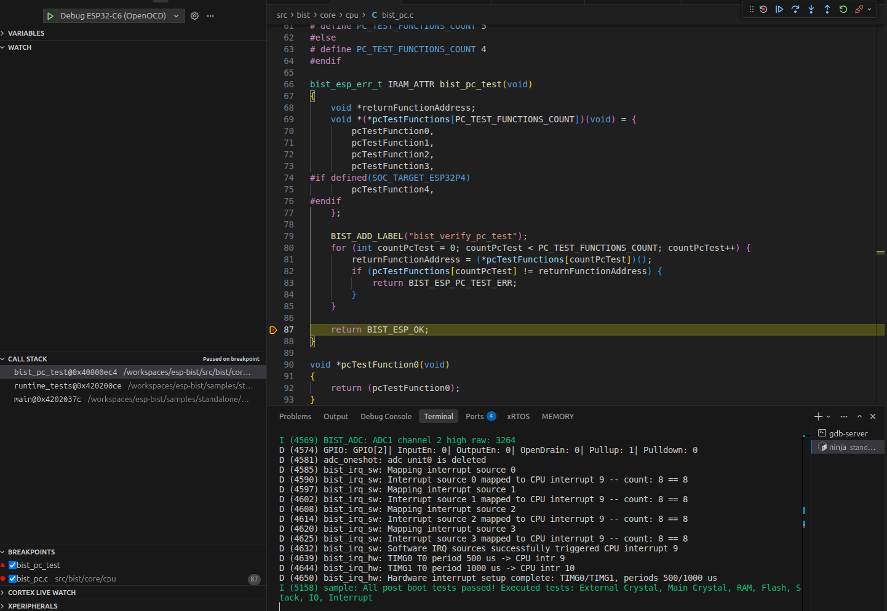

   Program counter integrity test successful

.. raw:: latex

   \clearpage

Error Injection
^^^^^^^^^^^^^^^

**Injection Method:**

PC integrity failure is injected via JTAG by modifying the PC or return address during function dispatch.

**Injected Fault:**

Program counter modified to execute ``pcTestFunction2`` instead of ``pcTestFunction1``, resulting in a return address mismatch.

**Execution Steps:**

1. Connect JTAG debugger and set breakpoint at PC test execution
2. Application calls ``bist_pc_test()`` during runtime tests
3. When breakpoint hits, alter program counter to execute ``pcTestFunction2`` instead of ``pcTestFunction1``
4. Function executes and returns address of ``pcTestFunction2``
5. Test compares return value against expected address of ``pcTestFunction1``
6. Address mismatch detected, test returns ``BIST_ESP_PC_TEST_ERR`` (error code 5)

**Expected Behavior:**

- Program counter redirected via JTAG
- Test detects unexpected return address
- Test returns error code ``BIST_ESP_PC_TEST_ERR``
- Fail-safe exit is triggered as expected

Evidence Collection
^^^^^^^^^^^^^^^^^^^

**Error Injection Evidence:**

- Debugger state showing PC redirected to wrong function address

**Error Detection Evidence:**

- Serial log indicating PC return address verification mismatch
- Return code evaluates to ``BIST_ESP_PC_TEST_ERR``

**System Response Evidence:**

- Test correctly returns ``BIST_ESP_PC_TEST_ERR``
- Fail-safe exit is triggered as expected

**Screenshots/Logs:**

- Screenshot showing program counter integrity test failure (see :numref:`fig-pc-fail`):

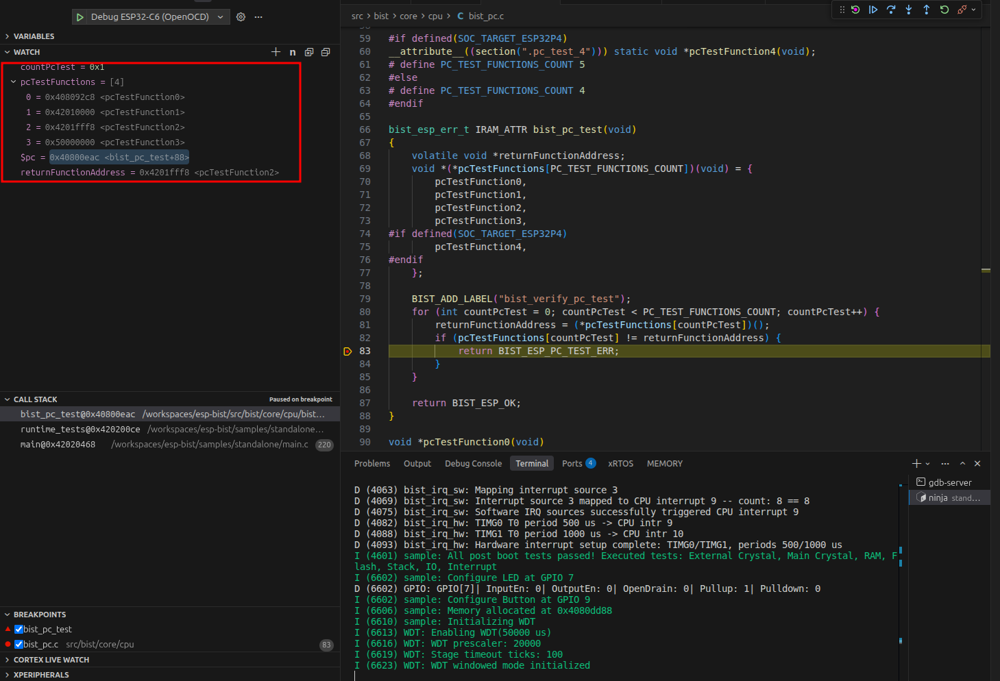

   Program counter integrity test failure

- Screenshot showing log of program counter integrity test failure (see :numref:`fig-pc-fail-log`):

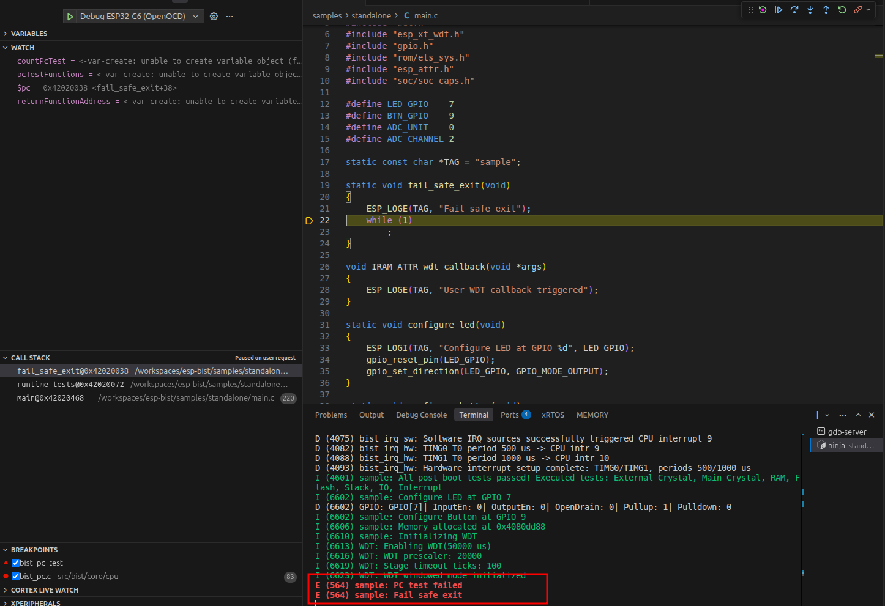

   Program counter integrity test failure log

.. raw:: latex

   \clearpage

Test 16: Windowed Watchdog Operation Test
-----------------------------------------

**Purpose:** Verify that the windowed watchdog timer enforces minimum and maximum feeding intervals and detects underflow timing violations when fed before the window opens.

**Test Component:** Windowed Main Watchdog Timer (MWDT with High-Resolution ``esp_timer`` Underflow Window)

Successful Run
^^^^^^^^^^^^^^

**Description:**

In the standalone application, ``wdt_init_windowed(CONFIG_ESP_BIST_WDT_WINDOWED_UNDERFLOW_TIMEOUT_US)`` configures windowed watchdog supervision alongside the standard MWDT. The feed window initializes open (``window_open_flag = true``) so the initial ``wdt_feed()`` succeeds. Each subsequent feed pets the hardware MWDT, closes the window (``window_open_flag = false``), and starts an ``esp_timer`` one-shot timer for the underflow period. When the timer expires, ``wdt_windowed_underflow_callback()`` opens the feed window. The application runtime loop executes periodic self-tests and feeds the watchdog only after the window has opened, preventing underflow while keeping the MWDT from expiring. This runtime test is distinct from the two-boot reset verification in Test 1.

**Execution Steps:**

1. Application initializes MWDT and calls ``wdt_init_windowed()``
2. First ``wdt_feed()`` executes successfully, resetting MWDT and starting underflow timer
3. Runtime loop executes self-tests and awaits feed margin (window opens)
4. Periodic ``wdt_feed()`` calls execute within the permitted window
5. ``wdt_is_underflow_detected()`` remains false throughout execution

**Expected Behavior:**

- Feeds occur exclusively while the underflow window is open
- Hardware MWDT does not expire; no underflow violation occurs
- Application executes continuously without reset

**Evidence:**

- Screenshot showing successful windowed watchdog operation test (see :numref:`fig-window-ok`):

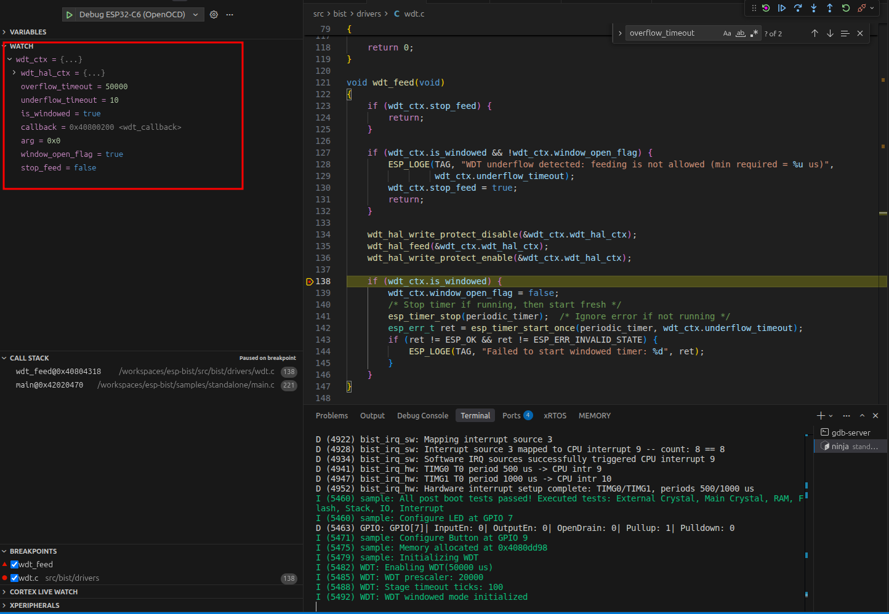

   Windowed watchdog operation test successful

.. raw:: latex

   \clearpage

Error Injection
^^^^^^^^^^^^^^^

**Injection Method:**

Timing fault is injected by invoking ``wdt_feed()`` prematurely while the underflow window is closed.

**Injected Fault:**

Watchdog feed attempted during the closed underflow window.

**Execution Steps:**

1. Application executes in windowed WDT mode
2. JTAG or modified test code triggers a second ``wdt_feed()`` immediately following the first feed
3. Driver detects ``wdt_ctx.is_windowed && !wdt_ctx.window_open_flag``
4. Driver logs underflow error: ``"WDT underflow detected: feeding is not allowed"``
5. Driver sets ``wdt_ctx.stop_feed = true`` and ignores further feeds
6. Hardware MWDT stage timeout expires due to feed cessation, triggering system reset

**Expected Behavior:**

- Underflow violation detected by watchdog driver
- Further watchdog petting disabled
- Hardware MWDT resets system due to intentional feed starvation
- Reset reason identifies watchdog reset on subsequent boot

Evidence Collection
^^^^^^^^^^^^^^^^^^^

**Error Injection Evidence:**

- Debugger inspection showing back-to-back ``wdt_feed()`` calls within underflow interval

**Error Detection Evidence:**

- Serial log showing ``"WDT underflow detected: feeding is not allowed"``
- Status query ``wdt_is_underflow_detected()`` evaluates to true

**System Response Evidence:**

- Watchdog feeds permanently inhibited
- Hardware MWDT triggers core reset upon timeout expiration

**Screenshots/Logs:**

- Screenshot showing windowed watchdog operation test failure (see :numref:`fig-window-fail`):

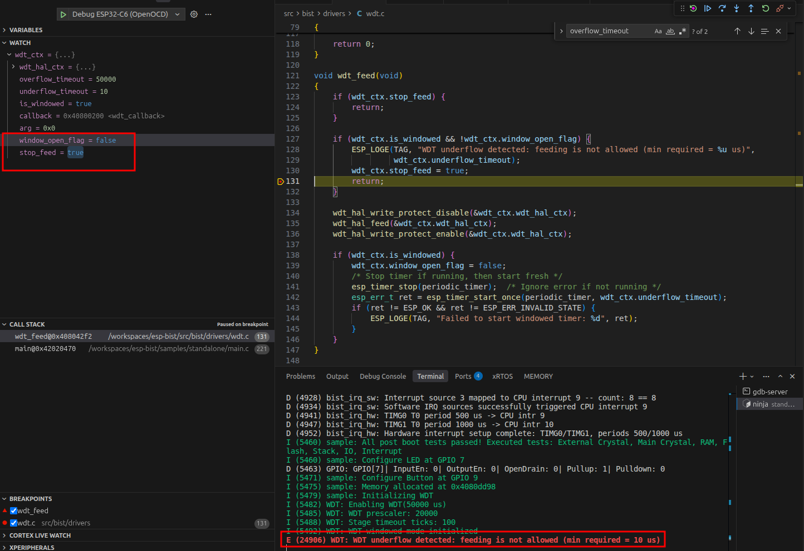

   Windowed watchdog operation test failure

- Screenshot showing the stop feed flag being set (see :numref:`fig-window-fail-stop-feed`):

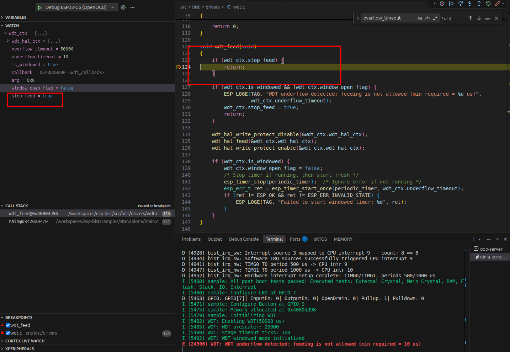

   Windowed watchdog operation test failure stop feed flag

- Screenshot showing log of windowed watchdog operation test failure (see :numref:`fig-window-fail-log`):

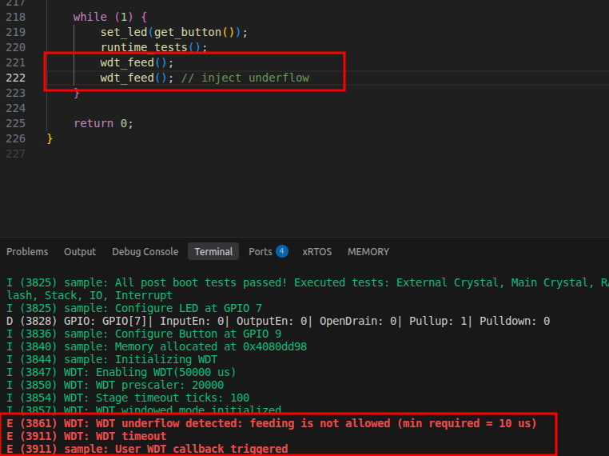

   Windowed watchdog operation test failure log

.. raw:: latex

   \clearpage
